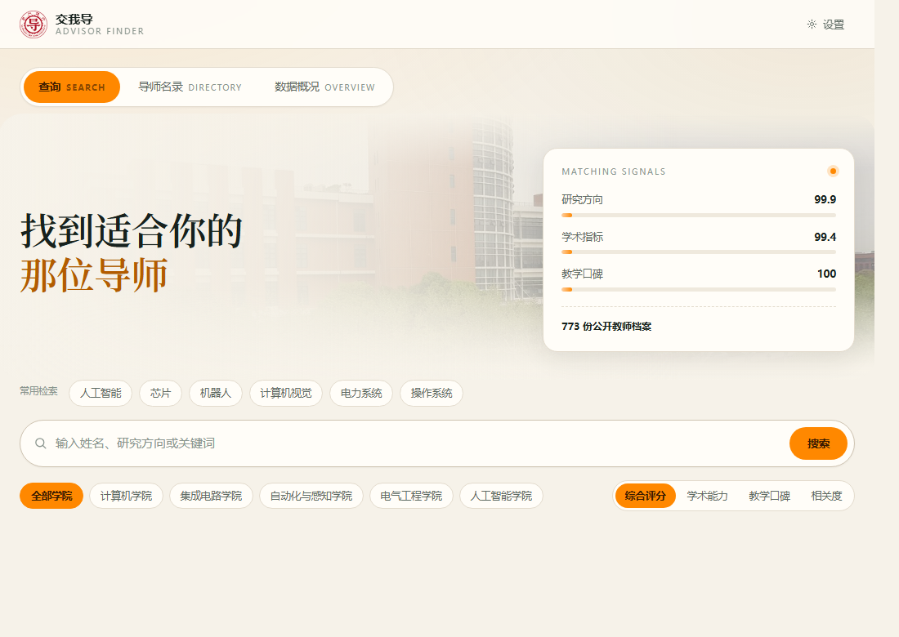
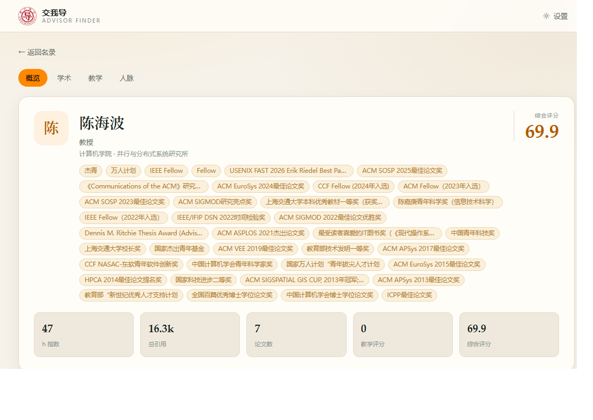
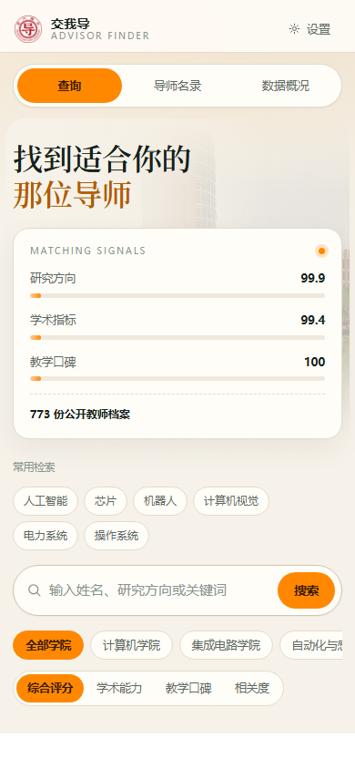
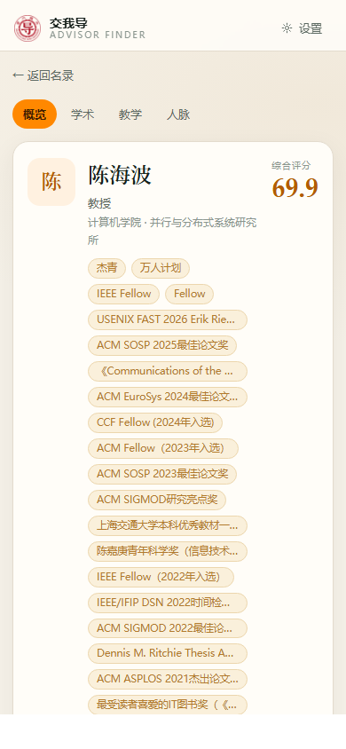

# Mining Faculty Profiles for Personalized Advisor Recommendation

Advisor Finder is a course project for the Data Mining course. The project collects public teacher pages from five schools of Shanghai Jiao Tong University, processes the data with data mining methods, and provides a desktop app and an Android app for searching and comparing advisors.

<table>
<tr>
<td></td>
<td>

The data layer collects teachers, papers, courses, and course reviews from school websites, the course review site, and public academic APIs, then writes them to SQLite.

The processing layer runs keyword extraction, similarity search, PageRank and HITS, Louvain community detection, K-means clustering, Apriori association rules, and the final score.

The application layer serves the data with Flask. The front end uses plain HTML, CSS, JavaScript, and ECharts. The desktop app opens a pywebview window. The mobile app uses an Android WebView and bundled offline data.

</td>
</tr>
</table>

## Screenshots

Desktop app:

<table>
<tr>
<td></td>
<td></td>
</tr>
</table>

Mobile app:

<table>
<tr>
<td></td>
<td></td>
</tr>
</table>

## Features

- Search teachers by name, pinyin, research direction, or keyword.
- Filter teachers by school.
- Sort by overall score, academic score, teaching score, or relevance.
- Teacher page with research directions, bio, score breakdown, contact, radar chart, collaboration network, similar advisors, courses, and papers.
- Click a research direction tag to open a related search.
- Light and dark themes, Chinese and English interface.
- AI assistant drawer on the desktop app and the mobile app. The assistant uses the local database first and can call public academic sources.
- The mobile app works offline. The AI service is optional.

## Project structure

```
Project/
├─ app/                        Application layer
│  ├─ app.py                   Flask routes
│  ├─ templates/index.html     Page
│  └─ static/                  CSS, JavaScript, images
├─ assistant/                  AI assistant
│  ├─ agent.py                 Intent planning, tool calls, answer
│  ├─ api.py                   Chat endpoint and fallback
│  ├─ rag.py                   BM25 index and graph expansion
│  ├─ retrieval.py             Local teacher search
│  ├─ nlu.py                   Question parsing
│  ├─ answer.py                Rule-based answers
│  ├─ tools.py                 arXiv, Crossref, Acemap, official pages
│  ├─ llm.py                   OpenAI-compatible client
│  └─ store.py                 Chat history and settings path
├─ crawler/                    Data layer
│  ├─ config.py                Paths and rules
│  ├─ cs_crawler.py            School of Computer Science
│  ├─ college_crawler.py       Other four schools
│  ├─ faculty_crawler.py       Advisor filter
│  ├─ course_community.py      Course review site
│  ├─ scholar_client.py        Semantic Scholar
│  ├─ arxiv_client.py          arXiv author lists
│  ├─ crossref_client.py       Crossref author lists
│  └─ openalex_client.py       OpenAlex (legacy cache)
├─ processing/                 Processing layer
│  ├─ preprocess.py            Cleaning, pinyin index, co-author network
│  ├─ keyword_extract.py       jieba + TF-IDF
│  ├─ similarity_index.py      MinHash + LSH
│  ├─ ranking.py               PageRank + HITS
│  ├─ community.py             Louvain
│  ├─ clustering.py            K-means
│  ├─ association.py           Apriori
│  └─ score.py                 Overall score
├─ mobile/                     Mobile app
│  ├─ android/                 Android WebView project
│  ├─ tools/export_data.py     Export offline data
│  └─ build_apk.ps1            APK build script
├─ scripts/                    Utility scripts
│  ├─ fix_honors.py            One-time honor year repair
│  └─ supplement_papers.py     Fill missing representative papers
├─ data/
│  ├─ db/mentor.db             SQLite database
│  └─ exports/                 Files used by the app
├─ docs/                       Screenshots and architecture image
├─ db.py                       Database schema
├─ run_pipeline.py             Data layer entry
├─ launcher.py                 Desktop entry
└─ environment/environment.yml Python environment
```

`data/raw/` is the crawl cache. It is ignored by Git and is not needed after cloning.

## Environment

Python 3.11.

```powershell
conda create -n dm-mentor python=3.11 -y
conda activate dm-mentor
pip install flask pywebview requests beautifulsoup4 lxml jieba pypinyin numpy pandas scikit-learn networkx mlxtend
```

## Run the desktop app

The database and processing results are already in the repository.

```powershell
python launcher.py
```

For browser debugging:

```powershell
python app/app.py
```

Then open http://127.0.0.1:8765

## AI assistant

The assistant reads the question, calls local search tools, and then writes the answer. Teacher cards and source links come from the tool results.

Local search uses a BM25 index and a graph step. The index covers research directions, keywords, honors, bio, paper titles, courses, institute, and school. Honors and research directions have higher weight. The graph step adds teachers who are close to the top lexical results through co-author edges and the same institute.

The assistant can also call arXiv, Crossref, Acemap, and public university pages. It does not call OpenAlex.

The API settings are in the settings panel of both apps. The endpoint, model, and key are set by the user.

On Windows, the desktop settings and chat history are stored in `%LOCALAPPDATA%\JiaWoDao`, not in the repository. On other systems the folder is `~/.jiaowodao`. The mobile app stores its settings in the WebView local storage.

When no key is set, the desktop app uses the rule-based answer path.

## Rebuild the data

```powershell
python run_pipeline.py
python run_pipeline.py --limit 50
```

The course review site needs an account. Read it from environment variables and do not write it into the code.

```powershell
$env:COURSE_COMMUNITY_EMAIL = "your email"
$env:COURSE_COMMUNITY_PASSWORD = "your password"
```

Run the processing steps in this order:

```powershell
cd processing
python preprocess.py
python keyword_extract.py
python similarity_index.py
python ranking.py
python community.py
python clustering.py
python association.py
python score.py
```

## Build the desktop app

```powershell
pyinstaller --noconfirm --onefile --windowed --name 交我导 --icon app.ico `
  --add-data "app/templates;app/templates" `
  --add-data "app/static;app/static" `
  --add-data "data/db/mentor.db;data/db" `
  --add-data "data/exports/collab_edges.csv;data/exports" `
  --add-data "data/exports/similar_pairs.json;data/exports" `
  --add-data "data/exports/association_rules.json;data/exports" `
  launcher.py
```

The output is `dist/交我导.exe`.

If the app shows an SSL error at startup, add the DLLs from the conda environment:

```powershell
  --add-binary "$env:CONDA_PREFIX\Library\bin\libssl-3-x64.dll;." `
  --add-binary "$env:CONDA_PREFIX\Library\bin\libcrypto-3-x64.dll;." `
  --add-binary "$env:CONDA_PREFIX\Library\bin\ffi.dll;." `
  --add-binary "$env:CONDA_PREFIX\Library\bin\liblzma.dll;." `
  --add-binary "$env:CONDA_PREFIX\Library\bin\libexpat.dll;." `
  --add-binary "$env:CONDA_PREFIX\Library\bin\libbz2.dll;."
```

## Mobile app

The mobile app reuses the desktop pages. The data is exported to `data.js` and loaded by the WebView without a network connection.

Set the Android SDK and JDK before the build:

```powershell
$env:ANDROID_SDK_ROOT = "path to your Android SDK"
$env:JAVA_HOME = "path to your JDK"
```

Export the data and build the APK:

```powershell
python mobile/tools/export_data.py
powershell -ExecutionPolicy Bypass -File mobile/build_apk.ps1
```

The output is `mobile/dist/jiaowodao-mobile.apk`.

The mobile app loads pages from `https://appassets.androidplatform.net/assets/www/`. The lookup order is assets, res/raw, then file://.

## Data and methods

Data sources:

- Public teacher pages of five schools of Shanghai Jiao Tong University.
- Public course reviews from the course review site.
- Papers and citations from Semantic Scholar and OpenAlex.
- Author lists from arXiv and Crossref.

Representative papers for teachers without paper records are filled by `scripts/supplement_papers.py`. The script reads the teacher name and research directions, searches OpenAlex, and keeps works where the author name matches, the author is affiliated with Shanghai Jiao Tong University, the field fits the school, and the title or topic matches the research directions. Crossref is used as a second source. Each record stores title, year, citation count, venue, DOI, and authors. The script also repairs two-digit years in older records.

The current database has 773 teachers, 13,092 papers, and 1,663 courses. Paper records exist for 721 teachers. The other 52 teachers have no matched paper.

| Module | Method | Course topic |
|---|---|---|
| preprocess.py | Pinyin index, author extraction, co-author network | Data cleaning and integration |
| keyword_extract.py | jieba tokenizer + TF-IDF | Text feature extraction |
| similarity_index.py | Shingling + MinHash + LSH | Similar item search |
| ranking.py | PageRank + HITS | Link analysis |
| community.py | Louvain | Community detection |
| clustering.py | K-means | Clustering |
| association.py | Apriori | Association rules |
| score.py | Weighted normalization | Overall score |

Processing results:

- Keywords for 773 teachers.
- 103 similar advisor pairs.
- Co-author network with 2,347 edges and 676 teachers.
- 20 Louvain communities, modularity 0.678.
- 8 K-means topic clusters.
- 11 association rules.
- Overall score for 773 teachers.

## Overall score

```
score = (0.10 * papers + 0.20 * citations + 0.35 * honors + 0.25 * teaching) * 100
```

Each term uses 5% to 95% quantile normalization over the whole database:

```
norm(x) = clip((x - P5) / (P95 - P5), 0, 1)
```

| Term | Weight | Input |
|---|---|---|
| Papers | 0.10 | Number of papers |
| Citations | 0.20 | Total citations |
| Honors | 0.35 | Weighted talent titles plus a title baseline |
| Teaching | 0.25 | Course rating weighted by number of ratings |

498 teachers have course ratings. The average is 3.616. The other 275 teachers use this average in the score, while their teaching score still shows 0 and the teaching part of the breakdown is shown in red.

## Known issues

- Research directions are missing for 1 teacher, and bio is missing for 14 teachers.
- Institute is missing for 163 teachers, and a personal homepage is missing for 216 teachers.
- Citation count is missing for 23 teachers, paper count for 22, and h-index for 5.
- The cross-school co-author network matches authors by name. Authors with the same name may not be separated.
- Some teacher pages do not list award years. Honors keep only the years that the page confirms.
- 52 teachers still have no paper record after the supplement.

## Notes

The data comes from public web pages and public academic APIs and is used for course learning only. Keep the request rate low when crawling.

The repository contains public faculty profile data, including names and public contact emails from official pages. It does not contain account passwords, cookies, API keys, or access tokens. API keys are entered by the user at runtime and stored outside the repository. The release page provides the packaged desktop app and mobile app.
