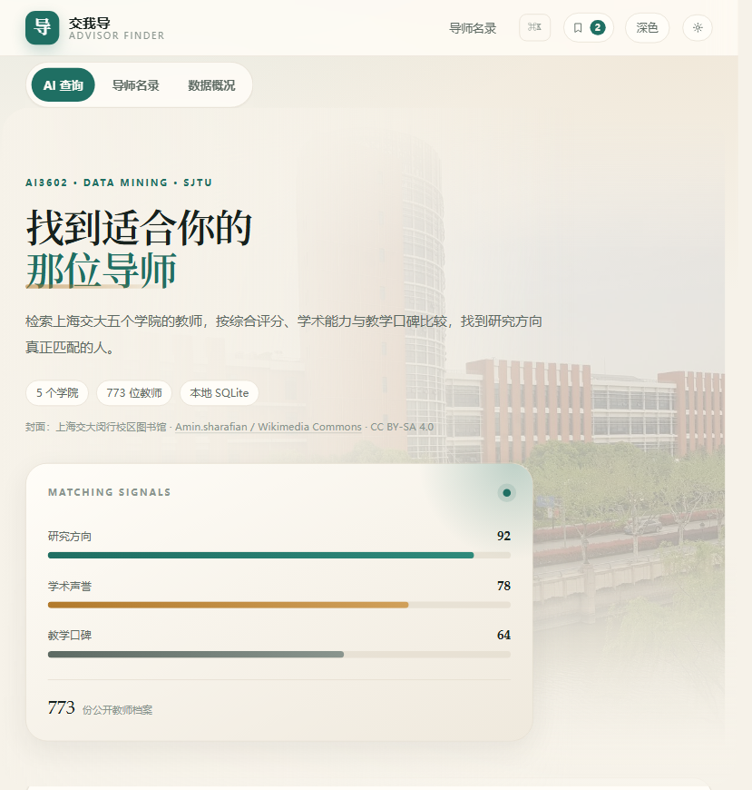
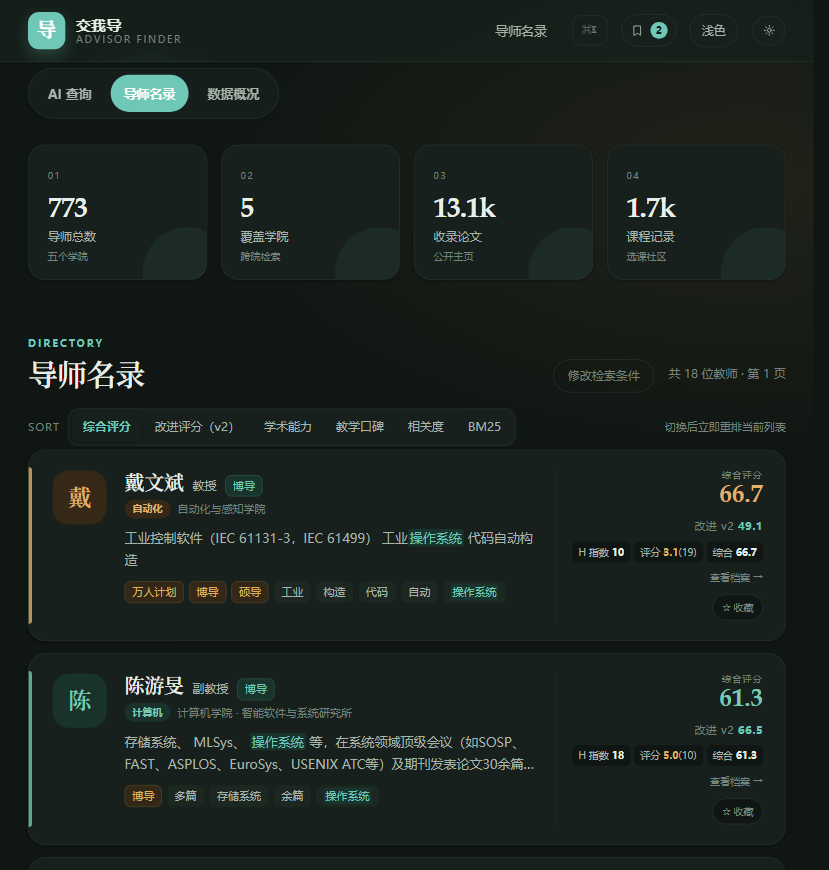
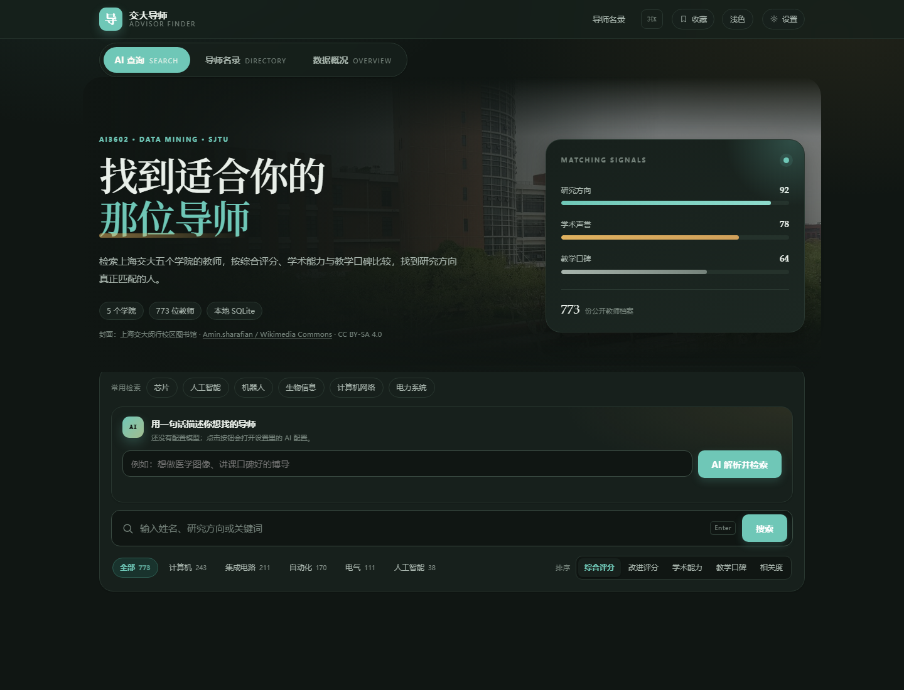
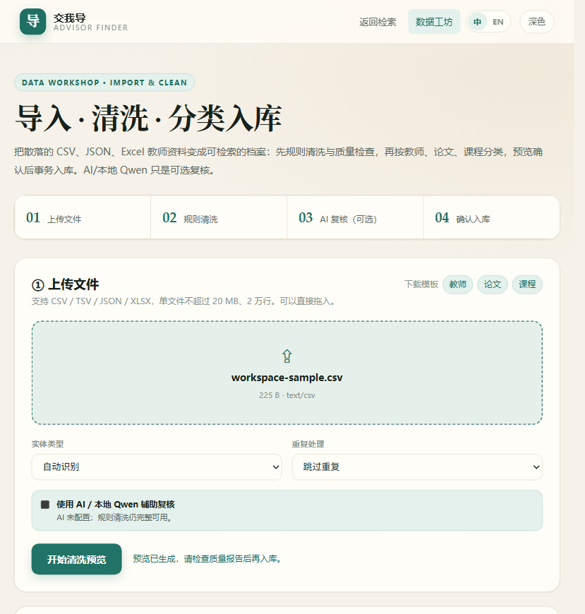
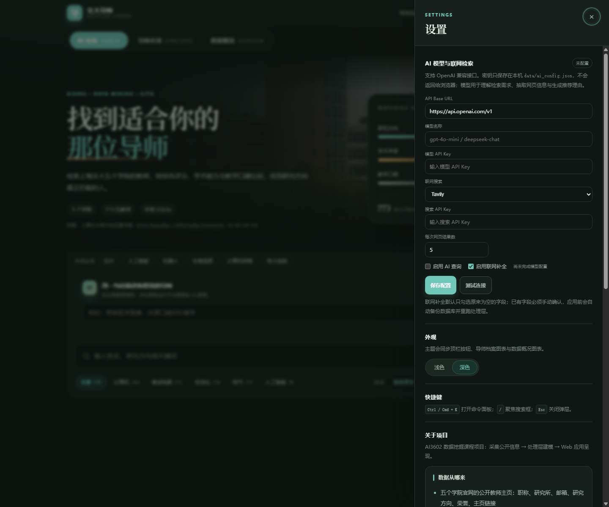
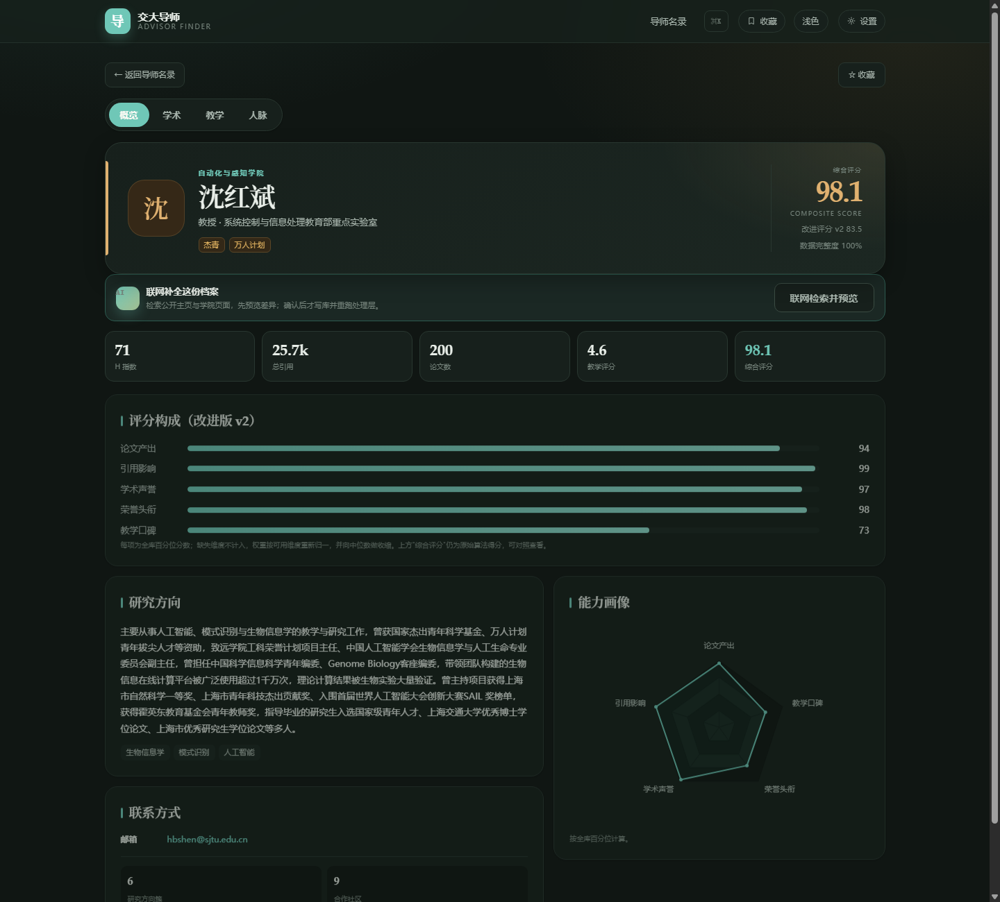
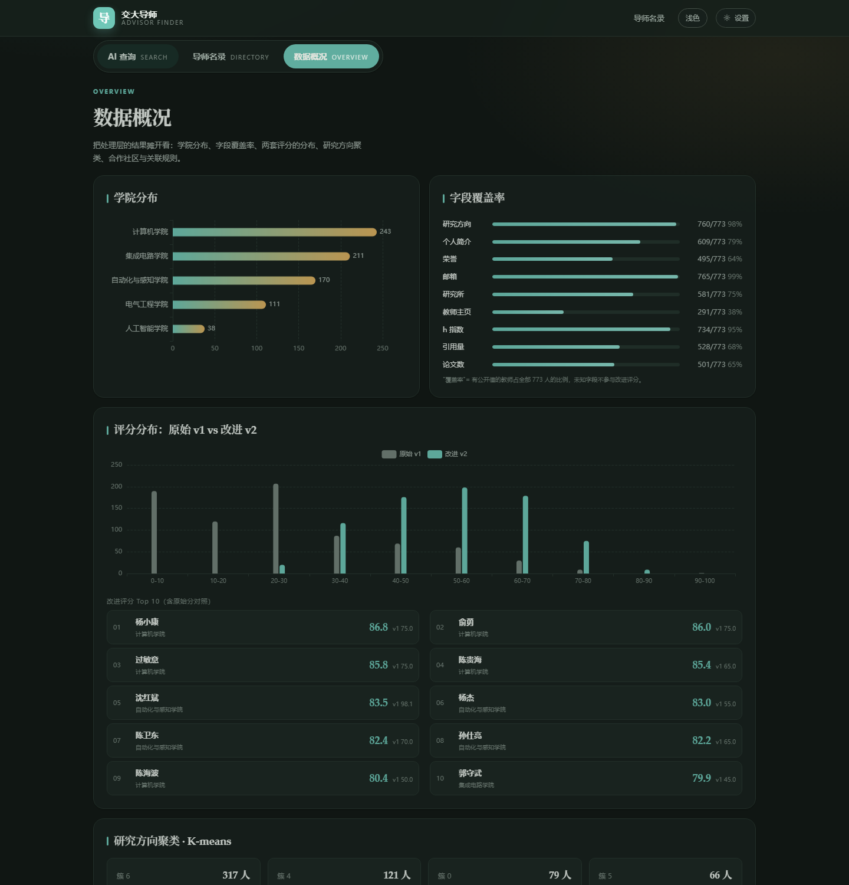
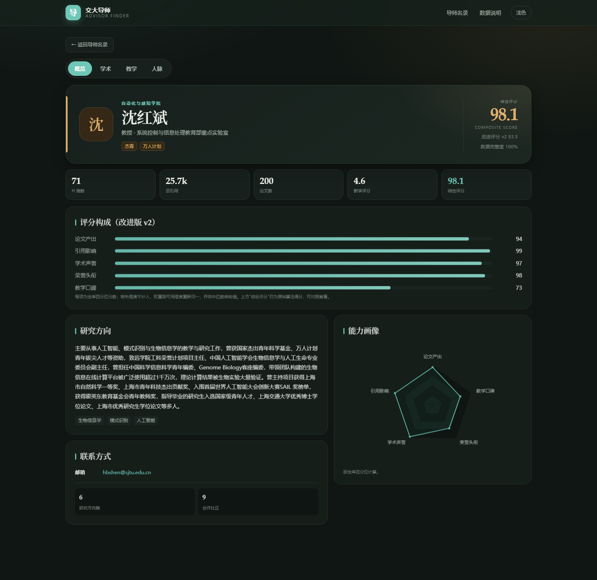
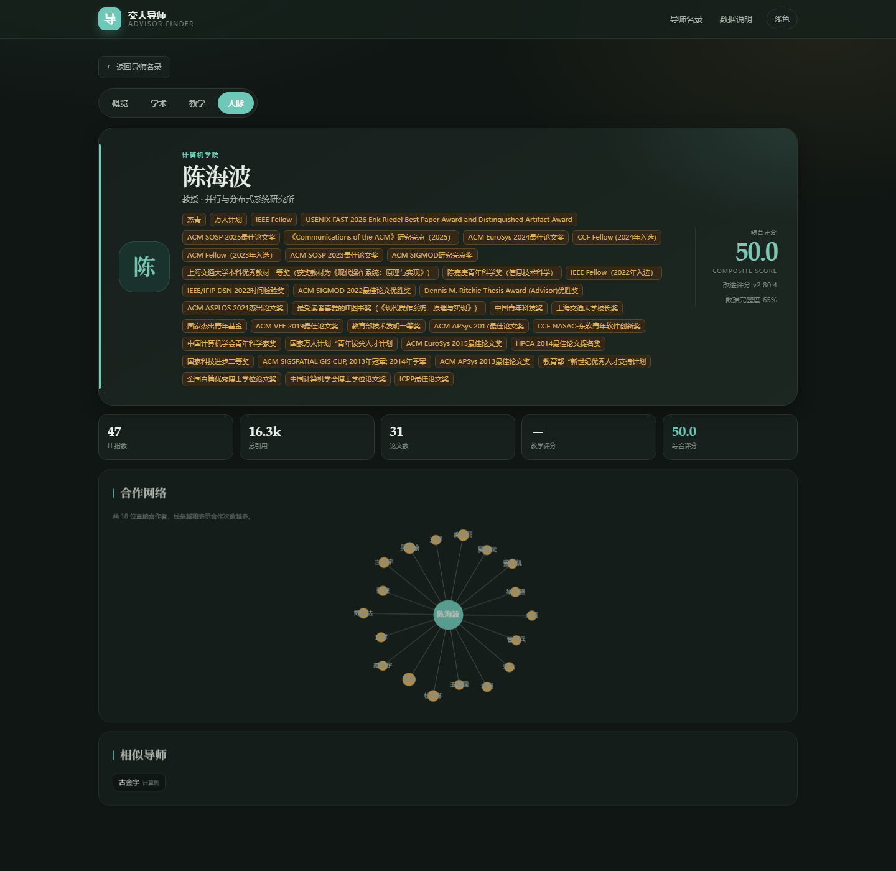

# Mining Faculty Profiles for Personalized Advisor Recommendation

上海交通大学五学院导师画像与选导师推荐系统（AI3602 数据挖掘课程项目）。

抓取学院官网、选课社区与学术数据库的公开信息，用课程中的方法做处理，最后提供一个可检索、
可比较的导师档案应用。当前接口版本 **v2.7.0**：在 v1.9 的 AI 查询/联网补全/数据工坊/BM25
底座上，合入 GitHub v2.7 的对话式导师助手（多轮对话、工具调用、arXiv/Crossref/官网来源）、
桌面底部 AI 抽屉、英文/拼音姓名检索与移动端触控修复；详见
[`docs/GitHub-v2.7-同步与合并.md`](docs/GitHub-v2.7-同步与合并.md)、
[`docs/v1.9-合并说明.md`](docs/v1.9-合并说明.md) 与
[`docs/数据挖掘改进路线.md`](docs/数据挖掘改进路线.md)；底层修复与公开项目对照见
[`docs/底层审查与数据挖掘改进.md`](docs/底层审查与数据挖掘改进.md)；本轮把检索、主题模型、
聚类与关联规则改为可配置/语料自学习组件，算法与泛化边界见
[`docs/数据挖掘-算法与泛化说明.md`](docs/数据挖掘-算法与泛化说明.md)。





















窄屏（500px）与亮色主题：`docs/v1.3-窄屏.png`、`docs/v1.2-封面-亮色.png`、
`docs/v1.1-洞察页-亮色.png`。

## 功能

- 按姓名、拼音、研究方向、关键词、研究所、职称检索，多级匹配打分
- 按学院筛选，可只看博导、只看有课程评分的教师
- 七种排序：综合评分、改进评分（v2）、学术能力、教学口碑、相关度、BM25、主题相关度；
  AI 查询页与导师名录页各自保存排序状态，互不串改，切换排序不会跳页
- **中英双语**：设置页可切换中文/English；导航、搜索、排序、AI 卡与设置文案即时翻译，
  检索条件保留在 URL 中
- **移动端**：Android WebView 离线工程已同步 v2.7（`versionCode 18`），数据 773 位教师 /
  15,083 篇论文；桌面端通过「设置 → 移动端预览」打开 `/mobile/` 预览同一套名录与档案界面
- **移动端 AI 助手（v2.7 同步）**：底部可拖拽三态抽屉，基于离线教师库做意图识别与
  RAG 证据检索，返回教师卡、命中依据与公开主页；可选 OpenAI 兼容 API 先检索后生成，失败
  自动回退规则回答。支持中文姓名、英文姓名与正反拼音检索；关系类问题（合作者/团队/实验室）
  会沿合作网络补充高权重邻居并说明 `graph_reason`；保留本机端点免 Key、测试连接、
  URL 白名单与超时保护，并补回上游的抽屉触控/焦点修复。Key 仅存本机 WebView。详见
  [`docs/移动端-AI助手与打包.md`](docs/移动端-AI助手与打包.md)
- 三个功能区并列切换：**AI 查询** / **导师名录** / **数据概况**；项目说明收敛进
  「设置」抽屉，不再和功能抢一级入口。档案页再分 **概览 / 学术 / 教学 / 人脉**
  四块，切换只做显示，不重排原布局
- AI 查询页：一句关键词、学院胶囊与常用检索 chips；提交后自动进入名录页，
  并在结果上方显示检索进度
- 「设置」抽屉：深浅色主题选择（与顶栏按钮、详情图表联动）、项目介绍、数据来源、
  两套评分口径、处理层方法与已知限制；首页和数据工坊共用同一个抽屉，进入工坊后
  设置入口不再消失，表单支持未保存提示、焦点陷阱和保存/测试防重复提交
- 首页封面使用真实校园照片（上海交大闵行校区图书馆，CC BY-SA 4.0，
  见 [`docs/图片来源.md`](docs/图片来源.md)），随深浅色主题调整明度
- 提交检索后自动切到名录页，在结果上方显示分阶段进度条：
  解析条件 → 匹配姓名与关键词 → 排序 → 生成列表
- 数据洞察页：学院分布、字段覆盖率、两套评分分布、自动 K 的研究方向簇、23 个研究相似社区、
  关联规则，以及 TF-IDF + NMF 主题模型（主题词、主题数与词表规模）
- 导师档案：评分构成（五维百分位）、数据完整度、能力雷达、合作网络、相似导师、
  讲授课程与评分、代表论文、联系方式
- 点击研究方向标签即可跳到相关教师；档案页可直接分享（`?teacher=401` / `#/teacher/401`）
- **我的收藏**：卡片与档案页可收藏导师，顶栏显示收藏数；抽屉内可勾选 2–4 人并排对比
  综合评分、v2、h 指数、引用、论文、教学评分与数据完整度，支持导出 CSV
- **检索体验**：输入即自动补全导师（姓名 / 学院 / 职称 / 评分），空输入显示最近 6 条检索；
  结果卡片对姓名、方向、标签做命中高亮
- **可分享检索状态**：`q`、`college`、`sort`、`page` 写回 URL，刷新或复制链接可恢复结果与排序
- **命令面板**：`Ctrl / Cmd + K` 打开，可切换三个功能区、打开收藏/设置、切换主题、
  搜索导师或复制当前链接；顶栏另有 `⌘K` 入口
- **AI 自然语言查询（v1.7 / 保留至 v1.9）**：查询页新增「用一句话描述你想找的导师」入口；模型先把需求解析为
  关键词、学院、职称、博导偏好与排序，再由本地语料执行检索，并给出整体说明与每位候选的推荐理由。
  没有配置模型时，按钮会引导到设置页，不会静默退回关键词检索
- **对话式导师助手（v2.7 合入）**：页面底部新增可拖拽 AI 抽屉，支持多轮追问、
  “再推荐几位”、教师详情、实验室/同研究所、两位教师比较、学院名单与最新成果；
  本地 BM25 + 合作网络扩展优先，必要时可调用 arXiv、Crossref、公开高校主页；
  无 Key 时自动使用规则回答，有 Key 时走“规划 → 工具调用 → 总结”。
  对话历史单独保存在本机 `chat.db`，不随 `mentor.db` 重建而丢失；聊天与 AI 查询共用
  设置页里的同一套模型配置，避免双 Key
- **模型配置放在设置**：支持 OpenAI 兼容 `chat/completions` 的 Base URL、模型名和 API Key；
  联网搜索支持 Tavily / Serper；密钥只保存在服务器本机 `data/ai_config.json`，前端只看到
  “已配置/未配置”，不会回传密钥原文
- **联网补全档案（v1.7）**：档案页「联网检索并预览」会搜索公开主页/学院页面，模型只按网页证据抽取
  职称、研究所、方向、邮箱、主页和简介；页面逐字段展示“当前 vs 建议”，默认只勾选原来为空的字段，
  已有值必须手动确认才会覆盖
- **写库与处理层刷新**：确认后先自动备份数据库，再以事务写入选中字段，随后后台依次重跑
  `keyword_extract → topic_model → similarity_index → ranking → community → clustering → association → score → score_v2`，
  前端显示每一步状态；关键词、主题画像、相似导师、聚类、评分与档案页会随库更新
- **BM25F 检索基线（v1.9）**：新增 `sort=bm25`，按姓名/拼音/关键词/研究方向/研究所/职称分字段加权；
  查询缩写与领域词来自 `data/mining/lexicon.json`，同时从当前语料自动学习“中文（缩写）”写法；
  索引随数据库 mtime 自动失效，旧排序与评分权重完全不变
- **通用挖掘组件（本轮新增）**：`app/mining.py` 不依赖 Flask，也不绑定当前数据库；
  提供中英文分词、NFKC 规范化、外部词典加载、语料缩写学习、TF-IDF + NMF 主题模型、
  主题查询投影、分数归一化/融合，以及 SVD + K-means 自动选 K
- **外置词典与语料自学习（本轮新增）**：`data/mining/lexicon.json` 含 26 个别名键和 53 个
  `areas`；换学科/换学校时替换该 JSON 或设置 `MENTOR_LEXICON_PATH`，不需要改 Python；
  缩写还可从当前语料的“中文（ML）”写法自动学习
- **主题相关度（本轮新增）**：`processing/topic_model.py` 用 TF-IDF + NMF 生成主题画像
  （当前 K=8、773 篇文档、词表 1,254）；`sort=topic` 在 BM25 召回集内按 0.6/0.4 融合主题分数，
  NDCG@10 从 0.768 提升到 0.798，不改变 `score/score2` 权重
- **主题画像接口（本轮新增）**：`GET /api/mining` 返回方法、K、文档数、词表大小、主题词和
  词典规模；`/api/insights` 增加 `topics` 区块；教师摘要/详情增加 `topic_primary`、
  `topic_label`、`topic_distribution`，洞察页新增「主题模型 · TF-IDF + NMF」面板
- **离线检索评估（v1.9）**：`docs/eval/queries.json` + `scripts/evaluate_retrieval.py`，
  输出规则 / BM25 / 纯主题 / 混合四种方法的 NDCG@10 / MAP@10 / HitRate@10 / P@5，
  当前结果 BM25F 0.768、混合 0.798；纯主题 0.097 只作诊断，不单独用于排序。详见
  `docs/eval/results.md`
- **荣誉时间线（本轮新增）**：数据工坊不再用普通逗号切荣誉，`2025年，上海市科技进步一等奖`
  会保留“年份 + 奖项”的完整关系；服务端统一过滤“国内奖励：/论文奖励：”等分区标题，
  按年份倒序展示，并在详情接口新增 `honor_stats`（有年份比例、最新年份、近五年数量、类别分布）。
  `score_v2` 对能解析出年份的称号增加温和时效权重（0.75 下限、10 年半衰期），
  无年份条目不衰减；原始 `score` 权重不变。详见
  [`docs/2026-11-26-荣誉年份与挖掘功能改进.md`](docs/2026-11-26-荣誉年份与挖掘功能改进.md)
- **数据工坊（本轮新增）**：`/workspace` 独立页面支持手动导入 CSV / JSON / XLSX，
  规则清洗、质量报告、教师/论文/课程分类、重复检测、预览确认后事务入库；
  可选调用 OpenAI 兼容 API 或本地 Ollama/Qwen 做辅助复核，模型不生成缺失事实；
  应用前自动备份，入库后可选后台重跑 9 步处理层。任务 token 写入 `?job=`，
  刷新或复制链接可恢复同一预览；服务重启后中断的处理层任务会自动标记为失败，
  不会永久停在 running。详见
  [`docs/数据工坊-导入与清洗.md`](docs/数据工坊-导入与清洗.md)、
  [`docs/2026-11-26-应用服务与数据工坊加固.md`](docs/2026-11-26-应用服务与数据工坊加固.md)

## 快速开始

**Windows 一键运行**：双击项目根目录的 `run.bat` 即可。脚本会自动检查
`.venv` 与依赖（缺失时创建环境并安装），检查数据库与端口，启动服务后打开浏览器；
停止服务按 `Ctrl+C`。

```bat
run.bat                 默认 8765 端口并自动打开浏览器
run.bat 8766            换一个端口（端口被占用时）
run.bat --no-browser    只启动服务，不开浏览器
```

`run.bat` 全部使用 ASCII 与 CRLF，避免中文批处理在 cmd 里乱码；端口等待逻辑放在
`scripts/open_browser.py`。

手动启动：

```powershell
# 1. 建环境
python -m venv .venv
.\.venv\Scripts\python.exe -m pip install -r requirements-dev.txt

# 2. 启动（数据库里已有处理好的结果，开箱即可用）
.\.venv\Scripts\python.exe -m app.app
#    浏览器打开 http://127.0.0.1:8765
#    桌面窗口：.\\.venv\\Scripts\\python.exe launcher.py（需 pip install ".[desktop]"）
```

```powershell
# 测试 & 静态检查
.\.venv\Scripts\python.exe -m pytest tests -q          # 129 passed
.\.venv\Scripts\ruff.exe check app processing scripts tests assistant
node --check app\static\js\app.js
node --check app\static\js\insights.js
node --check app\static\js\i18n.js
```

或用 conda：`conda create -n dm-mentor python=3.11 -y` 后 `pip install -r requirements-dev.txt`。

### 配置 AI 与联网补全

启动后打开右上角「设置 → AI 模型与联网检索」，填写：

| 字段 | 说明 |
|---|---|
| API Base URL | OpenAI 兼容地址，例如 `https://api.openai.com/v1`、`https://api.deepseek.com/v1` |
| 模型名称 | 例如 `gpt-4o-mini`、`deepseek-chat`；需支持 `/chat/completions` |
| 模型 API Key | 只保存到本机 `data/ai_config.json`，GET 接口不会返回 |
| 联网搜索 | `Tavily` 或 `Serper（Google）`，用于自动查公开教师主页 |
| 搜索 API Key | Tavily / Serper 的 Key；只用于服务端搜索请求 |
| 每次网页结果数 | 1–10，默认 5 |

保存后点「测试连接」会做一次最小模型调用；若同时启用联网，会额外返回一次搜索条数。
也可以用环境变量临时覆盖（适合课程演示，不写入配置文件）：

```powershell
$env:MENTOR_AI_BASE = "https://api.openai.com/v1"
$env:MENTOR_AI_MODEL = "gpt-4o-mini"
$env:MENTOR_AI_KEY = "sk-..."
$env:MENTOR_SEARCH_PROVIDER = "tavily"
$env:MENTOR_SEARCH_KEY = "tvly-..."
.\.venv\Scripts\python.exe -m app.app
```

没有 API Key 时，所有原有检索、名录、档案、洞察、收藏功能仍可正常使用；AI 查询和联网补全
会返回明确的 `ai_not_configured` / `search_not_configured` 错误，并引导到设置页。

### 移动端预览与 APK

```powershell
run.bat
# 浏览器打开 http://127.0.0.1:8765/mobile/
```

移动端与 APK 共用 `mobile/android/assets/www`。底部 AI 抽屉默认只用本地教师库；可在
「设置 → AI 服务」填 OpenAI 兼容站点/模型/Key，本机端点（如
`http://127.0.0.1:11434/v1`）可留空 Key。Key 只存本机 WebView，不写入仓库。

打包需要 Android SDK + JDK：

```powershell
$env:ANDROID_SDK_ROOT = "C:\Users\<你>\AppData\Local\Android\Sdk"
$env:JAVA_HOME = "C:\Program Files\Eclipse Adoptium\jdk-17..."
powershell -ExecutionPolicy Bypass -File .\mobile\build_apk.ps1
# 输出 mobile\dist\jiaowodao-mobile.apk（versionName 2.7）
```

APK 内页面是 HTTPS asset origin，`MIXED_CONTENT_NEVER_ALLOW` 会拦截明文 HTTP 端点；
手机端接本机模型需 HTTPS。完整说明见
[`docs/移动端-AI助手与打包.md`](docs/移动端-AI助手与打包.md)。

## 目录结构

```
├─ run.bat                   Windows 一键启动（ASCII + CRLF，自动建环境/起服务/开浏览器）
├─ assistant/                v2.7 对话式导师助手（独立模块，不改原 app 蓝图）
│  ├─ api.py                 /api/chat：状态、设置、测试、历史、发送、清空
│  ├─ agent.py               模型规划 → 工具调用 → 总结
│  ├─ nlu.py / rag.py        意图槽位、BM25 + 合作网络扩展
│  ├─ retrieval.py           只读 mentor.db；中文/英文/拼音姓名解析
│  ├─ tools.py               arXiv / Crossref / Acemap 入口 / 公开高校页面
│  ├─ answer.py              规则回答、教师卡、来源与建议问题
│  ├─ llm.py                 OpenAI 兼容调用，复用 app/ai_config.py
│  └─ store.py               独立 chat.db 对话历史
├─ app/                      应用层（Flask）
│  ├─ __init__.py            create_app：配置、日志、蓝图、错误处理、gzip、缓存头
│  ├─ config.py              默认配置 + 环境变量覆盖
│  ├─ db.py                  只读连接、请求级连接、WAL、索引自检、文件戳
│  ├─ services.py            检索语料/统计/百分位/相似与合作映射/排序/主题分数/详情组装
│  ├─ api.py                 /api 蓝图：health、meta、stats、colleges、search、teacher、mining
│  ├─ mining.py              通用数据挖掘：词典、缩写学习、NMF、自动 K、混合分数（新增）
│  ├─ ai_api.py              /api/ai：配置、测试、自然语言检索、补全预览/应用/任务
│  ├─ ai_config.py           AI 配置读写、密钥掩码、环境变量覆盖
│  ├─ ai_client.py           OpenAI 兼容 Chat Completions、Tavily/Serper、网页抓取
│  ├─ ai_search.py           意图解析 + 本地候选检索 + 推荐理由
│  ├─ ai_enrich.py           联网补全、字段 diff、备份写入、处理层任务
│  ├─ ai_store.py            AI 暂存/审计表（只新增表）
│  ├─ insights.py            /api/insights：学院分布、覆盖率、评分分布、聚类、社区、规则、主题
│  ├─ app.py                 兼容入口（python -m app.app 或 python app/app.py）
│  ├─ templates/index.html   首页
│  ├─ templates/workspace.html 数据工坊
│  ├─ templates/_settings_drawer.html 首页/工坊共享的设置抽屉
│  ├─ templates/error.html   非 API 的 HTML 错误页（带请求编号）
│  └─ static/                样式、脚本、ECharts
│     ├─ css/style.css       基础样式
│     ├─ css/app-tabs.css    一级/二级分区导航样式（新增）
│     ├─ css/app-shell.css   共享外壳、设置抽屉、焦点样式
│     ├─ css/workspace.css   数据工坊样式
│     ├─ css/ai-features.css AI 查询、设置、补全弹窗样式（新增）
│     ├─ css/chat.css       底部对话抽屉样式（v2.7 合入）
│     ├─ js/app.js           检索、档案渲染、图表、主题排序
│     ├─ js/app-shell.js     设置抽屉开关、焦点陷阱、主题同步
│     ├─ js/ai-settings.js   设置页模型/搜索配置、校验与脏状态
│     ├─ js/workspace.js     数据工坊：上传、预览、入库、处理层进度、URL 恢复
│     ├─ js/ai-search.js     查询页自然语言检索（新增）
│     ├─ js/ai-enrich.js     档案页联网补全预览与任务进度（新增）
│     ├─ js/chat.js          桌面 AI 对话抽屉（v2.7 合入）
│     ├─ js/app-tabs.js      名录 / 洞察 / 说明 切换（新增）
│     ├─ js/insights.js      洞察页图表与列表（新增）
│     └─ js/detail-tabs.js   档案页 概览/学术/教学/人脉 切换（新增）
├─ crawler/                  数据层（一次性采集脚本）
│  ├─ config.py              路径与规则配置
│  ├─ cs_crawler.py          计算机学院抓取
│  ├─ college_crawler.py     其余四个学院抓取
│  ├─ faculty_crawler.py     导师筛选与身份识别
│  ├─ course_community.py    选课社区课程评分
│  ├─ openalex_client.py     OpenAlex 学术指标
│  └─ scholar_client.py      Semantic Scholar 学术指标
├─ processing/               处理层
│  ├─ text_utils.py          领域词表/停用词/分词（关键词与聚类共用）
│  ├─ preprocess.py          拼音索引、论文年份、合作网络
│  ├─ keyword_extract.py     jieba + TF-IDF 关键词
│  ├─ topic_model.py         TF-IDF + NMF 主题模型（新增）
│  ├─ similarity_index.py    Shingling + MinHash + LSH
│  ├─ ranking.py             PageRank + HITS
│  ├─ community.py           Louvain 社区发现
│  ├─ clustering.py          SVD + K-means，轮廓系数自动选 K
│  ├─ association.py         Apriori，词典/语料动态项集
│  ├─ score.py               原始四维综合评分 + teaching_imputed
│  ├─ score_v2.py            改进版评分 v2
│  └─ refresh.py             只重算处理层（AI 写库后 / 手动重跑）
├─ scripts/
│  ├─ integrate_sources.py          GitHub + 补录 + 当前库三源整合，写审计表与报告
│  ├─ repair_paper_source_status.py 恢复 paper_sources 的来源/核验状态
│  ├─ merge_authoritative_data.py  补录整合版并入项目库（自动备份、去重、年份修复）
│  ├─ supplement_papers.py         用 OpenAlex/Crossref 补代表论文（v2.7 合入）
│  ├─ data_quality_report.py       生成数据质量报告
│  ├─ evaluate_retrieval.py        规则/BM25/纯主题/混合四方法离线评估
│  ├─ ingest_cs_names.py           计算机学院姓名补录
│  └─ open_browser.py              run.bat 用：等服务健康后打开浏览器
├─ data/
│  ├─ db/mentor.db           SQLite 数据库
│  ├─ db/backup/             合并前的自动备份
│  ├─ mining/lexicon.json    领域词典（别名 + 关联规则项集，可替换）
│  ├─ raw/                   爬取缓存（未入库，可由 run_pipeline.py 重新生成）
│  └─ exports/               处理结果、评分明细、数据质量与合并报告
├─ tests/                    pytest：接口契约、数据完整性、评分逻辑、文本处理
├─ mobile/                   Android WebView 离线端
│  ├─ android/assets/www/    离线页面、教师数据、移动 AI 助手（mobile-ai.js）
│  ├─ android/src/           MainActivity（assets/res/raw 资源服务、返回键桥）
│  └─ build_apk.ps1          aapt2 + javac + d8 + zipalign + apksigner 打包脚本
├─ docs/
│  ├─ 改进说明.md            v1.1–v1.7 改了什么、为什么
│  ├─ 数据合并口径.md         合并规则与回滚方式
│  ├─ API.md                 接口文档
│  ├─ 数据工坊-导入与清洗.md 导入、清洗、质量分、并发写库、URL 恢复与截图
│  ├─ 2026-11-26-应用服务与数据工坊加固.md 设置共享、任务恢复、HTTP 边界与验收
│  ├─ 移动端-AI助手与打包.md 移动 AI 原理、配置、加固、APK 构建与验收
│  ├─ GitHub-v2.7-同步与合并.md  v2.7 逐文件对比、合并取舍与本地独有功能
│  ├─ 数据质量报告.md         自动生成的字段覆盖与异常统计
│  ├─ 底层审查与数据挖掘改进.md 本轮 bug 修复、公开项目对照与改进清单
│  ├─ 2026-11-26-审查复核与修复记录.md 第三方审查逐条复核、修复项与权威数字
│  ├─ 数据挖掘-算法与泛化说明.md 公式、复杂度、泛化边界与课程知识点对应
│  └─ 设计文档.md             最初的方案文档
├─ db.py                     表结构与写入（数据层）
├─ run_pipeline.py           数据采集入口
├─ launcher.py               桌面壳入口
├─ pyproject.toml            依赖分组、pytest、ruff 配置
├─ requirements*.txt
├─ Makefile                  install / pipeline / data / quality / serve / test / lint
└─ .github/workflows/ci.yml  lint + pytest
```

## 数据与算法

数据来自学院官网公开教师主页、选课社区课程评价、Semantic Scholar / AMiner 学术指标，
以及 `导师信息补录_258-515` 最终交付的官方补录快照。
当前库：**773 位教师**（计算机 243、集成电路 211、自动化与感知 170、电气 111、人工智能 38）、
**15,083 篇论文**、**1663 条课程记录**。字段覆盖与异常见 [`docs/数据质量报告.md`](docs/数据质量报告.md)。

> 2026-11-26 整合后的权威口径：以改进版原库为底，GitHub 原版论文/作者/学术指标为主源，
> 补录整合版只填空和补论文；论文 15,083 条（新增补录 2,544 条、按教师+归一化标题去重），
> 有论文教师 721 人、`authors` 非空 2,013 条、合作边 2,938 条、PageRank/HITS 覆盖 729 人。
> 每条新增论文的来源与核验状态见库内 `paper_sources`，整合过程见
> [`docs/2026-11-26-数据整合与网络核验.md`](docs/2026-11-26-数据整合与网络核验.md)。
> `docs/GitHub-v2.7-同步与合并.md`、`docs/v1.9-合并说明.md` 等是当时的历史快照，其中的
> 13,088/13,092 等数字保留用于追溯，不再代表当前库。

| 模块 | 方法 | 课程知识点 |
|---|---|---|
| preprocess.py | 拼音索引、作者抽取、年份修复 | 数据清洗与集成 |
| keyword_extract.py | jieba 分词 + TF-IDF（领域词表 + 停用词） | 文本特征抽取 |
| similarity_index.py | Shingling + MinHash + LSH，Jaccard ≥ 0.25 | 相似项检索 |
| ranking.py | PageRank + HITS（按 h 指数定向） | 链接分析 |
| community.py | 关键词 kNN 相似图 + Louvain（模块度 0.6831，23 个研究相似社区） | 社区发现 |
| clustering.py | SVD 降维 + K-means，轮廓系数自动选 K（当前 K=8） | 聚类 |
| association.py | Apriori（词典/语料动态项集，min_support 0.02 / min_conf 0.3） | 关联规则 |
| topic_model.py | TF-IDF + NMF（主题词、教师-主题分布） | 主题模型/降维 |
| app/retrieval.py | BM25F + 外置词典/语料缩写 | 文本检索、向量空间 |
| scripts/evaluate_retrieval.py | NDCG@10 / MAP@10 / HitRate@10 / P@5 | 检索评估 |
| score.py | 原始四维加权：论文 0.10 + 引用 0.20 + 荣誉 0.35 + 教学 0.25；教学缺失用全库均值填充并标记 `teaching_imputed` | 综合评分 |
| score_v2.py | 五维分位数排名 + 缺失感知加权 + 收缩先验 + 荣誉年份时效（改进评分，与原始分并列展示） | 综合评分 |

### 检索、主题与评估

- **BM25F**：姓名 4.0、拼音 2.5、关键词 2.0、方向 2.0、研究所/职称 1.0；`df` 按教师去重，
  避免同一词出现在多个字段时被重复计数。
- **NMF 主题模型**：TF-IDF 矩阵分解为教师-主题矩阵和主题-词矩阵；K 由语料规模与轮廓系数
  自动选择，当前 **K=8、773 篇文档、词表 1,254**。主题标签示例：
  `智能/模型/机器人`、`电力/电力系统/市场`、`芯片/器件/集成`、`安全/人工智能/数据`。
- **主题混合排序**：`sort=topic` 只在 BM25 召回集内融合，
  `0.6 * norm(BM25) + 0.4 * norm(主题相似度)`；没有主题结果时退化为 BM25。
- **接口落点**：`GET /api/mining` 返回 `method/k/document_count/vocabulary/topics/lexicon`；
  `/api/search?sort=topic` 返回 `topic`（混合分）与 `topic_similarity`（纯主题分）；
  `/api/insights` 增加 `topics`；教师摘要/详情增加 `topic_primary`、`topic_label`、
  `topic_distribution`。
- **检索评估**（10 条人工标注查询）：

| 方法 | NDCG@10 | MAP@10 | P@5 |
|---|---:|---:|---:|
| 规则相关度 | 0.954 | 0.925 | 0.920 |
| BM25F | 0.768 | 0.673 | 0.680 |
| 纯主题模型 | 0.097 | 0.050 | 0.080 |
| BM25 + 主题（0.6/0.4） | **0.798** | **0.703** | 0.660 |

纯主题分数只作画像诊断；单独排序会丢失词法证据，因此不作为默认排序。完整公式、复杂度与
换数据步骤见 [`docs/数据挖掘-算法与泛化说明.md`](docs/数据挖掘-算法与泛化说明.md)。

### 课程公式与参数

- **TF-IDF**：`tfidf(t,d) = tf(t,d) * (log((1+N)/(1+df(t))) + 1)`；
  关键词用 `min_df=2`、`max_df=0.85`，主题模型用 `max_df=0.70`。
- **BM25F**：按字段加权 `tf_w` 计算，`df` 按教师文档去重；姓名 4.0、拼音 2.5、
  关键词/方向 2.0、研究所/职称 1.0。
- **NMF**：`X ≈ W H`；`W` 是教师-主题权重（行归一化），`H` 是主题-词权重；
  K 候选 4–10，下界随 `sqrt(N)/3.5` 增长，再用轮廓系数选择。
- **SVD + K-means**：TF-IDF 先降到最多 50 维，再在 K=4–8 上用轮廓系数
  `s(i)=(b(i)-a(i))/max(a(i),b(i))` 选 K；当前 K=8，轮廓系数 0.0744。
- **Apriori**：`support=|A∪B|/N`、`confidence=|A∪B|/|A|`、
  `lift=confidence/support(B)`；项集来自词典 `areas` 或语料高频词。
- **检索评估**：NDCG@10 关注排序位置折扣，MAP@10 关注相关项的平均精度，
  P@5 看前 5 条命中比例；当前混合 0.798 / 0.703 / 0.660。

### 泛化设计（换一批数据时）

- **词典外置**：`data/mining/lexicon.json` 的 `aliases` 与 `areas` 可替换；
  `MENTOR_LEXICON_PATH` 可指向新词典。
- **缩写自学习**：`learn_acronyms()` 从当前语料的“中文（ML）”模式抽取，不写死 ML/CV/NLP。
- **自动 K**：主题数与聚类 K 都由语料规模和轮廓系数决定；聚类前先做 TruncatedSVD 降维，
  避免高维稀疏 TF-IDF 直接算欧氏距离。
- **动态项集**：Apriori 优先读词典 `areas`，缺失时从当前语料 TF-IDF 高频词生成；
  支持 `MENTOR_RULE_SUPPORT` 调整支持度。
- **结果 JSON 化**：主题模型只保存主题词权重和教师-主题分布，不依赖 sklearn 模型对象；
  换数据后重跑 `topic_model.py`、`clustering.py`、`association.py` 即可。
- **边界**：字段语义仍是“教师画像”，不是任意表格零配置；新数据至少要能映射出
  `name`、`research_directions`/`research_topics`、`keywords` 等字段。

数据库主要表：

- `teachers`：姓名、拼音、学院、职称、邮箱、研究方向、简介、荣誉、h 指数、引用量、论文数、主页等
- `papers`：标题、年份、发表处、被引、作者
- `courses`：课程名、课程号、评分、评分人数、学期
- `processing`：关键词、主题、聚类、社区、PageRank、HITS、教学评分、综合评分、评分分项、覆盖度

### 重新采集与重算

```powershell
# 采集（需要网络；选课社区需要登录态）
$env:COURSE_COMMUNITY_EMAIL = "你的邮箱"
$env:COURSE_COMMUNITY_PASSWORD = "你的密码"
python run_pipeline.py            # 全量
python run_pipeline.py --limit 50 # 小样本

# 把补录结果并入项目库并重算处理层
python scripts/merge_authoritative_data.py --source "<mentor-整合版.db>"
python processing/preprocess.py && python processing/keyword_extract.py
python processing/topic_model.py && python processing/similarity_index.py
python processing/ranking.py && python processing/community.py
python processing/clustering.py && python processing/association.py
python processing/score.py && python processing/score_v2.py
# 或只重算处理层（不抓取、不重建库）
python processing/refresh.py

# 数据质量报告与检索评估
python scripts/data_quality_report.py
python scripts/evaluate_retrieval.py
```

## 配置

| 环境变量 | 默认 | 说明 |
|---|---|---|
| `MENTOR_DB_PATH` | `data/db/mentor.db` | 数据库路径 |
| `MENTOR_HOST` | `127.0.0.1` | 监听地址 |
| `MENTOR_PORT` | `8765` | 监听端口 |
| `MENTOR_LOG_LEVEL` | `INFO` | 日志级别 |
| `MENTOR_IMPORT_DIR` | `data/imports` | 导入预览行文件目录 |
| `MENTOR_IMPORT_BACKUP_DIR` | `data/backup` | 导入前数据库备份目录 |
| `MENTOR_COLLAB_CSV` | `data/exports/collab_edges.csv` | 合作边文件 |
| `MENTOR_SIMILAR_JSON` | `data/exports/similar_pairs.json` | 相似教师文件 |
| `MENTOR_MAX_UPLOAD_BYTES` | `26214400` | 上传大小上限（25 MB） |
| `MENTOR_PIPELINE_TIMEOUT` | `300` | 处理层单步超时（秒） |
| `MENTOR_STATIC_MAX_AGE` | `0` | 静态资源缓存秒数；0 表示 ETag 重新校验 |
| `MENTOR_GZIP_MIN_BYTES` | `800` | gzip 最小字节数 |
| `MENTOR_APP_VERSION` | `2.7.0` | 健康检查/接口展示版本 |
| `MENTOR_AI_CONFIG` | `data/ai_config.json` | AI 配置文件路径（密钥文件，已加入 .gitignore） |
| `MENTOR_AI_BASE` | 空 | 覆盖 API Base URL |
| `MENTOR_AI_MODEL` | 空 | 覆盖模型名称 |
| `MENTOR_AI_KEY` | 空 | 覆盖模型 API Key（设置后自动启用 AI） |
| `MENTOR_SEARCH_PROVIDER` | 空 | 覆盖联网搜索提供方 |
| `MENTOR_SEARCH_KEY` | 空 | 覆盖搜索 API Key |
| `MENTOR_LEXICON_PATH` | `data/mining/lexicon.json` | 外置领域词典；换学科/学校时替换 |
| `MENTOR_TOPICS_JSON` | `data/exports/topics.json` | 主题模型 JSON 路径 |
| `MENTOR_TOPIC_K` | 自动 | 固定主题数（调试/课程演示） |
| `MENTOR_CLUSTER_MAX` | `8` | 自动聚类 K 上限 |
| `MENTOR_RULE_SUPPORT` | `0.02` | Apriori 最小支持度 |

## 已知问题

- 合作网络（PageRank/HITS）覆盖 729 人：以原版 arXiv/Crossref 合作边为基线，合并本次可从
  `papers.authors` 对齐的边；其余教师仍因作者缩写/同名无法可靠对齐，合作边不代表完整合作关系
- 引用量覆盖 722 人、论文数 752 人，其余为 NULL（未知），不参与综合评分；详情页会标注数据完整度
- 论文年份仍有 2876 篇缺失；h 指数大于论文总数 159 人（跨来源口径差异）
- 补录新增的 2,544 篇论文多数没有结构化作者，因此不会新增合作边；只影响论文检索与主题语料
- 教学评分只统计选课社区有点评的课程（498 人）
- 关联规则受研究方向文本长度与项集口径影响，当前 5 条；换学科时替换
  `data/mining/lexicon.json` 的 `areas`，不要用旧词表解释新数据
- **纯主题模型不适合单独排序**：当前纯主题 NDCG@10 仅 0.097；应用中的 `sort=topic`
  是 BM25 召回集内的混合排序（0.798），不是纯主题排序
- **评估集仍小**：10 条人工标注查询只能做课程级对比，尚未扩到 50 条、0/1/2 分级与显著性检验
- **自动 K 是启发式**：主题数用“语料规模下界 + 轮廓系数”选，当前 K=8；换数据后应检查主题词是否可解释
- **泛化尚未在第二套真实异构数据上验收**：外置词典、缩写学习、自动 K 与动态项集已有合成数据测试，
  但换学校/学院仍需重跑处理层并核对字段语义
- **AI 功能需要自备 API Key**：v1.7 不内置任何模型或搜索 Key；未配置时查询页会引导到设置，
  联网补全不可用，但原有检索/名录/档案/洞察不受影响
- **模型抽取可能出错**：联网补全只给出“建议值 + 来源 + 置信度”，默认不覆盖已有字段；
  应用前请逐字段核对，误写可用 `data/db/backup/mentor_before_ai_*.db` 回滚
- **联网结果有时效与口径差异**：网页可能过期、学院页面结构变化或搜索服务限流；
  失败时任务会标记 `failed`，不会静默写入
- **处理层刷新是重算而非增量**：应用补全后会重跑 9 个步骤（含主题模型），教师多时可能需要几十秒；
  刷新前已自动备份数据库
- **模型/搜索调用会产生费用**：请使用自己的 Key，并在设置里控制每次网页结果数（1–10）

## 说明

项目数据来自公开网页，只用于课程学习；爬取时请控制请求频率。排序结果仅作检索辅助，
不构成选导师建议。
