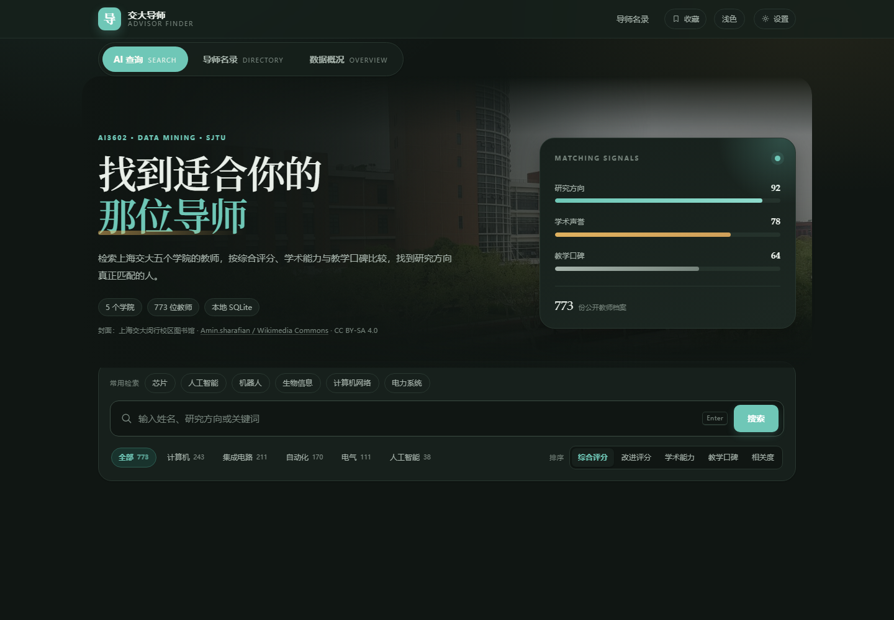
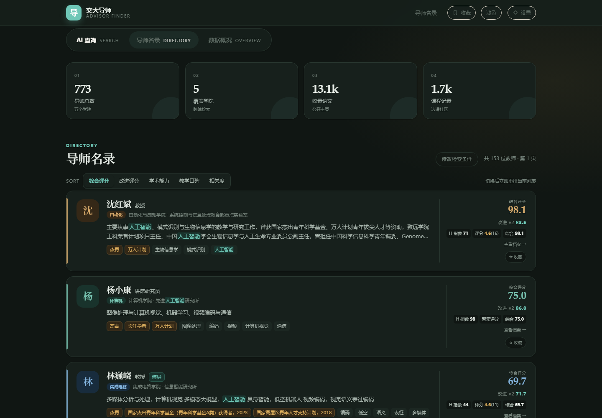
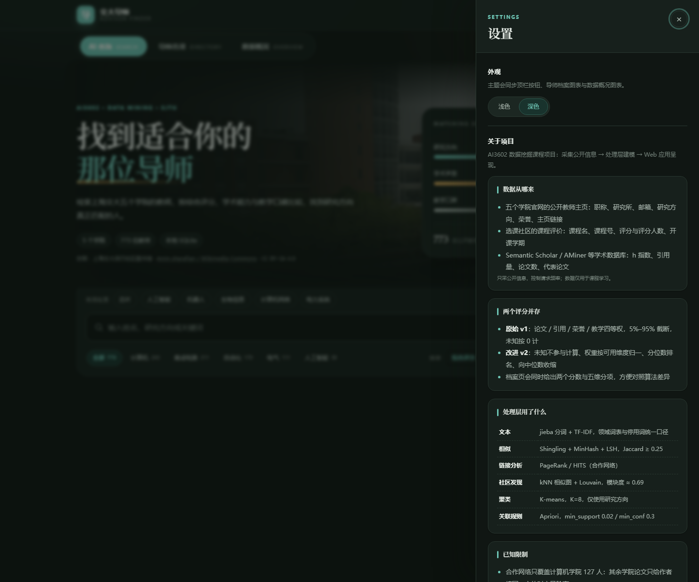
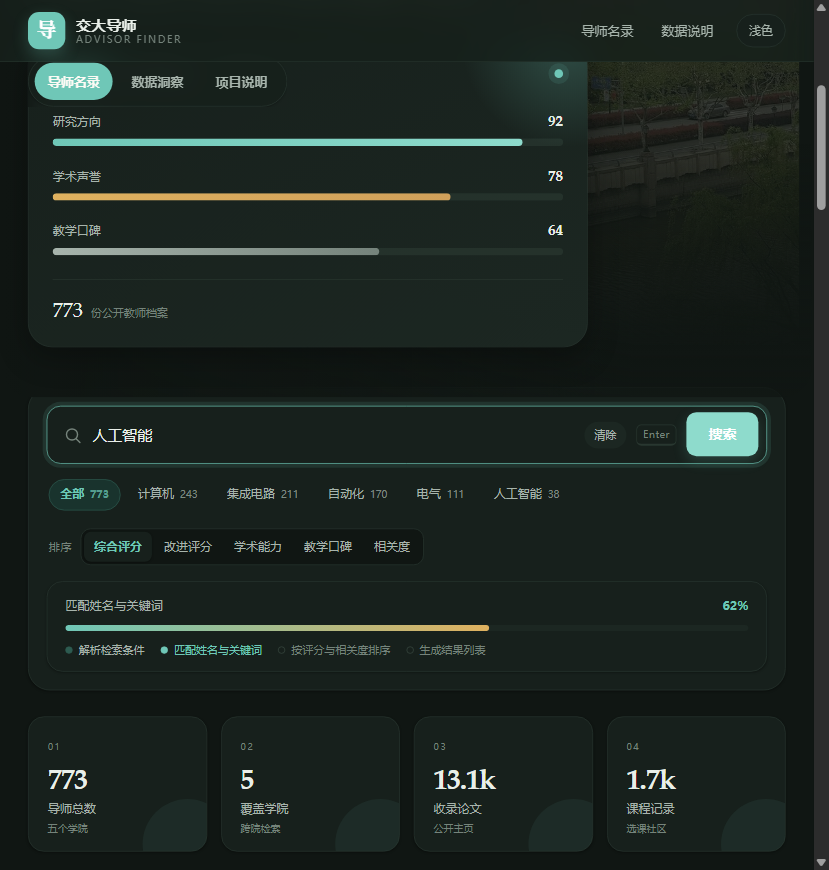

# Mining Faculty Profiles for Personalized Advisor Recommendation

上海交通大学五学院导师画像与选导师推荐系统（AI3602 数据挖掘课程项目）。

抓取学院官网、选课社区与学术数据库的公开信息，用课程中的方法做处理，最后提供一个可检索、
可比较的导师档案应用。当前接口版本 **v1.1.0**，界面经过 v1.2–v1.6 增量：
数据口径、评分算法、后端工程化与测试均有更新，界面按「AI 查询 / 导师名录 / 数据概况 + 设置」重组，
详见 [`docs/改进说明.md`](docs/改进说明.md)。










窄屏（500px）与亮色主题：`docs/v1.3-窄屏.png`、`docs/v1.2-封面-亮色.png`、
`docs/v1.1-洞察页-亮色.png`。

## 功能

- 按姓名、拼音、研究方向、关键词、研究所、职称检索，多级匹配打分
- 按学院筛选，可只看博导、只看有课程评分的教师
- 五种排序：综合评分、改进评分（v2）、学术能力、教学口碑、相关度；
  AI 查询页与导师名录页各自带排序控件，切换排序不会跳页
- 三个功能区并列切换：**AI 查询** / **导师名录** / **数据概况**；项目说明收敛进
  「设置」抽屉，不再和功能抢一级入口。档案页再分 **概览 / 学术 / 教学 / 人脉**
  四块，切换只做显示，不重排原布局
- AI 查询页：一句关键词、学院胶囊与常用检索 chips；提交后自动进入名录页，
  并在结果上方显示检索进度
- 「设置」抽屉：深浅色主题选择（与顶栏按钮、详情图表联动）、项目介绍、数据来源、
  两套评分口径、处理层方法与已知限制
- 首页封面使用真实校园照片（上海交大闵行校区图书馆，CC BY-SA 4.0，
  见 [`docs/图片来源.md`](docs/图片来源.md)），随深浅色主题调整明度
- 提交检索后自动切到名录页，在结果上方显示分阶段进度条：
  解析条件 → 匹配姓名与关键词 → 排序 → 生成列表
- 数据洞察页：学院分布、字段覆盖率、两套评分分布、8 个研究方向簇、23 个合作社区、11 条关联规则
- 导师档案：评分构成（五维百分位）、数据完整度、能力雷达、合作网络、相似导师、
  讲授课程与评分、代表论文、联系方式
- 点击研究方向标签即可跳到相关教师；档案页可直接分享（`?teacher=401` / `#/teacher/401`）
- **我的收藏**：卡片与档案页可收藏导师，顶栏显示收藏数；抽屉内可勾选 2–4 人并排对比
  综合评分、v2、h 指数、引用、论文、教学评分与数据完整度，支持导出 CSV
- **检索体验**：输入即自动补全导师（姓名 / 学院 / 职称 / 评分），空输入显示最近 6 条检索；
  结果卡片对姓名、方向、标签做命中高亮
- **可分享检索状态**：`q`、`college`、`sort`、`page` 写回 URL，刷新或复制链接可恢复结果与排序
- **命令面板**：`Ctrl / Cmd + K` 打开，可切换三个功能区、打开收藏/设置、切换主题、
  搜索导师或复制当前链接；顶栏另有 `⌘K` 入口

## 快速开始

**Windows 一键运行**：双击项目根目录的 `run.bat` 即可。脚本会自动检查
`.venv` 与依赖（缺失时创建环境并安装），检查数据库与端口，启动服务后打开浏览器；
停止服务按 `Ctrl+C`。

```bat
run.bat                 默认 8765 端口并自动打开浏览器
run.bat 8766            换一个端口（端口被占用时）
run.bat --no-browser    只启动服务，不开浏览器
```

`run.bat` 全部使用 ASCII 与 CRLF，避免中文批处理在 cmd 里乱码；端口等待逻辑放在
`scripts/open_browser.py`。

手动启动：

```powershell
# 1. 建环境
python -m venv .venv
.\.venv\Scripts\python.exe -m pip install -r requirements-dev.txt

# 2. 启动（数据库里已有处理好的结果，开箱即可用）
.\.venv\Scripts\python.exe -m app.app
#    浏览器打开 http://127.0.0.1:8765
#    桌面窗口：.\\.venv\\Scripts\\python.exe launcher.py（需 pip install ".[desktop]"）
```

```powershell
# 测试 & 静态检查
.\.venv\Scripts\python.exe -m pytest
.\.venv\Scripts\ruff.exe check app processing scripts tests
```

或用 conda：`conda create -n dm-mentor python=3.11 -y` 后 `pip install -r requirements-dev.txt`。

## 目录结构

```
├─ run.bat                   Windows 一键启动（ASCII + CRLF，自动建环境/起服务/开浏览器）
├─ app/                      应用层（Flask）
│  ├─ __init__.py            create_app：配置、日志、蓝图、错误处理、gzip、缓存头
│  ├─ config.py              默认配置 + 环境变量覆盖
│  ├─ db.py                  只读连接、请求级连接、WAL、索引自检、文件戳
│  ├─ services.py            检索语料/统计/百分位/相似与合作映射/排序/详情组装
│  ├─ api.py                 /api 蓝图：health、meta、stats、colleges、search、teacher
│  ├─ insights.py            /api/insights：学院分布、覆盖率、评分分布、聚类、社区、规则
│  ├─ app.py                 兼容入口（python -m app.app 或 python app/app.py）
│  ├─ templates/index.html   页面
│  └─ static/                样式、脚本、ECharts
│     ├─ css/style.css       基础样式
│     ├─ css/app-tabs.css    一级/二级分区导航样式（新增）
│     ├─ js/app.js           检索、档案渲染、图表
│     ├─ js/app-tabs.js      名录 / 洞察 / 说明 切换（新增）
│     ├─ js/insights.js      洞察页图表与列表（新增）
│     └─ js/detail-tabs.js   档案页 概览/学术/教学/人脉 切换（新增）
├─ crawler/                  数据层（一次性采集脚本）
│  ├─ config.py              路径与规则配置
│  ├─ cs_crawler.py          计算机学院抓取
│  ├─ college_crawler.py     其余四个学院抓取
│  ├─ faculty_crawler.py     导师筛选与身份识别
│  ├─ course_community.py    选课社区课程评分
│  ├─ openalex_client.py     OpenAlex 学术指标
│  └─ scholar_client.py      Semantic Scholar 学术指标
├─ processing/               处理层
│  ├─ text_utils.py          领域词表/停用词/分词（关键词与聚类共用）
│  ├─ preprocess.py          拼音索引、论文年份、合作网络
│  ├─ keyword_extract.py     jieba + TF-IDF 关键词
│  ├─ similarity_index.py    Shingling + MinHash + LSH
│  ├─ ranking.py             PageRank + HITS
│  ├─ community.py           Louvain 社区发现
│  ├─ clustering.py          K-means 研究方向聚类
│  ├─ association.py         Apriori 关联规则
│  └─ score.py               缺失感知的综合评分
├─ scripts/
│  ├─ merge_authoritative_data.py  补录整合版并入项目库（自动备份、去重、年份修复）
│  ├─ data_quality_report.py       生成数据质量报告
│  ├─ ingest_cs_names.py           计算机学院姓名补录
│  └─ open_browser.py              run.bat 用：等服务健康后打开浏览器
├─ data/
│  ├─ db/mentor.db           SQLite 数据库
│  ├─ db/backup/             合并前的自动备份
│  ├─ raw/                   爬取缓存（未入库，可由 run_pipeline.py 重新生成）
│  └─ exports/               处理结果、评分明细、数据质量与合并报告
├─ tests/                    pytest：接口契约、数据完整性、评分逻辑、文本处理
├─ docs/
│  ├─ 改进说明.md            v1.1 改了什么、为什么
│  ├─ 数据合并口径.md         合并规则与回滚方式
│  ├─ API.md                 接口文档
│  ├─ 数据质量报告.md         自动生成的字段覆盖与异常统计
│  └─ 设计文档.md             最初的方案文档
├─ db.py                     表结构与写入（数据层）
├─ run_pipeline.py           数据采集入口
├─ launcher.py               桌面壳入口
├─ pyproject.toml            依赖分组、pytest、ruff 配置
├─ requirements*.txt
├─ Makefile                  install / pipeline / data / quality / serve / test / lint
└─ .github/workflows/ci.yml  lint + pytest
```

## 数据与算法

数据来自学院官网公开教师主页、选课社区课程评价、Semantic Scholar / AMiner 学术指标。
当前库：**773 位教师**（计算机 243、集成电路 211、自动化与感知 170、电气 111、人工智能 38）、
**13088 篇论文**、**1663 条课程记录**。字段覆盖与异常见 [`docs/数据质量报告.md`](docs/数据质量报告.md)。

| 模块 | 方法 | 课程知识点 |
|---|---|---|
| preprocess.py | 拼音索引、作者抽取、年份修复 | 数据清洗与集成 |
| keyword_extract.py | jieba 分词 + TF-IDF（领域词表 + 停用词） | 文本特征抽取 |
| similarity_index.py | Shingling + MinHash + LSH，Jaccard ≥ 0.25 | 相似项检索 |
| ranking.py | PageRank + HITS（按 h 指数定向） | 链接分析 |
| community.py | kNN 相似图 + Louvain（模块度 0.6896，23 个社区） | 社区发现 |
| clustering.py | K-means（K=8，仅用研究方向） | 聚类 |
| association.py | Apriori（min_support 0.02 / min_conf 0.3） | 关联规则 |
| score.py | 五维分位数排名 + 缺失感知加权 + 收缩先验（原算法保留于 `score.py`，改进版为新文件 `score_v2.py`） | 综合评分 |

数据库主要表：

- `teachers`：姓名、拼音、学院、职称、邮箱、研究方向、简介、荣誉、h 指数、引用量、论文数、主页等
- `papers`：标题、年份、发表处、被引、作者
- `courses`：课程名、课程号、评分、评分人数、学期
- `processing`：关键词、聚类、社区、PageRank、HITS、教学评分、综合评分、评分分项、覆盖度

### 重新采集与重算

```powershell
# 采集（需要网络；选课社区需要登录态）
$env:COURSE_COMMUNITY_EMAIL = "你的邮箱"
$env:COURSE_COMMUNITY_PASSWORD = "你的密码"
python run_pipeline.py            # 全量
python run_pipeline.py --limit 50 # 小样本

# 把补录结果并入项目库并重算处理层
python scripts/merge_authoritative_data.py --source "<mentor-整合版.db>"
python processing/preprocess.py && python processing/keyword_extract.py
python processing/similarity_index.py && python processing/ranking.py
python processing/community.py && python processing/clustering.py
python processing/association.py && python processing/score.py && python processing/score_v2.py

# 数据质量报告
python scripts/data_quality_report.py
```

## 配置

| 环境变量 | 默认 | 说明 |
|---|---|---|
| `MENTOR_DB_PATH` | `data/db/mentor.db` | 数据库路径 |
| `MENTOR_HOST` | `127.0.0.1` | 监听地址 |
| `MENTOR_PORT` | `8765` | 监听端口 |
| `MENTOR_LOG_LEVEL` | `INFO` | 日志级别 |

## 已知问题

- 合作网络（PageRank/HITS）只覆盖计算机学院 127 人：只有该学院教师页公开完整作者列表，
  其余学院的论文引用串只有姓名缩写，实体对齐误配风险高
- 引用量覆盖 528 人、论文数 501 人，其余为 NULL（未知），不参与综合评分；详情页会标注数据完整度
- 论文年份仍有 3180 篇缺失；h 指数大于论文总数 92 人（跨来源口径差异）
- 教学评分只统计选课社区有点评的课程（498 人）
- 关联规则受研究方向文本长度限制，目前 11 条

## 说明

项目数据来自公开网页，只用于课程学习；爬取时请控制请求频率。排序结果仅作检索辅助，
不构成选导师建议。
