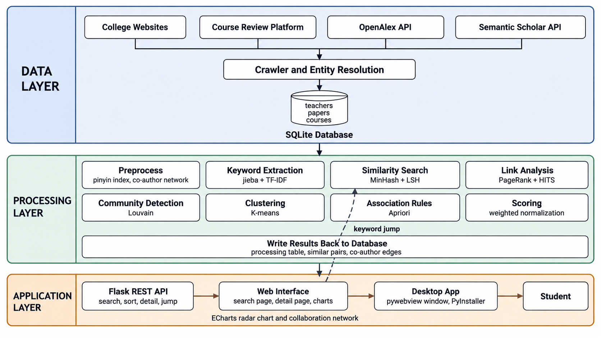
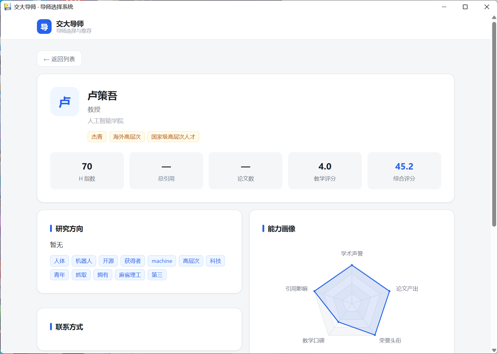

# Mining Faculty Profiles for Personalized Advisor Recommendation

基于数据挖掘课程进行设计。项目爬取上海交通大学五个学院的教师信息，用课程中的方法做处理，最后做成一个桌面应用，用来检索和比较导师。



## 功能

- 按姓名、拼音、研究方向、关键词检索教师
- 按学院筛选
- 四种排序：综合评分、学术能力、教学口碑、相关度
- 教师详情页：能力雷达图、合作网络图、相似导师、讲授课程与评分、代表论文
- 点击研究方向标签可以跳到相关教师




## 目录结构

```
Project/
├─ app/                     应用层
│  ├─ app.py                Flask 后端接口
│  ├─ templates/index.html  页面
│  └─ static/               样式、脚本、ECharts
├─ crawler/                 数据层
│  ├─ config.py             路径与规则配置
│  ├─ cs_crawler.py         计算机学院抓取
│  ├─ college_crawler.py    其余四个学院抓取
│  ├─ faculty_crawler.py    导师筛选与身份识别
│  ├─ course_community.py   选课社区课程评分
│  ├─ openalex_client.py    OpenAlex 学术指标
│  └─ scholar_client.py     Semantic Scholar 学术指标
├─ processing/              处理层
│  ├─ preprocess.py         清洗与索引
│  ├─ keyword_extract.py    关键词抽取
│  ├─ similarity_index.py   相似导师检索
│  ├─ ranking.py            影响力排名
│  ├─ community.py          社区发现
│  ├─ clustering.py         研究方向聚类
│  ├─ association.py        关联规则
│  └─ score.py              综合评分
├─ data/
│  ├─ db/mentor.db          SQLite 数据库
│  ├─ raw/                  爬取缓存
│  └─ exports/              处理结果与导出文件
├─ docs/设计文档.md          方案文档
├─ db.py                    数据库表结构与写入
├─ run_pipeline.py          数据层入口
├─ launcher.py              桌面应用入口
└─ environment/environment.yml
```

## 环境

Python 3.11。应用层依赖：

```
flask
pywebview
```

数据层依赖：

```
requests
beautifulsoup4
lxml
```

处理层依赖：

```
jieba
pypinyin
numpy
pandas
scikit-learn
networkx
mlxtend
```

可以用 conda 建环境：

```powershell
conda create -n dm-mentor python=3.11 -y
conda activate dm-mentor
pip install flask pywebview requests beautifulsoup4 lxml jieba pypinyin numpy pandas scikit-learn networkx mlxtend
```

## 运行

### 直接运行应用

数据库里已经有处理好的结果，克隆后可以直接打开界面。

```powershell
python launcher.py
```

也可以用浏览器调试：

```powershell
python app/app.py
```

然后访问 http://127.0.0.1:8765

### 重新爬取数据

```powershell
python run_pipeline.py
python run_pipeline.py --limit 50
```

选课社区需要登录，账号从环境变量读取：

```powershell
$env:COURSE_COMMUNITY_EMAIL = "你的邮箱"
$env:COURSE_COMMUNITY_PASSWORD = "你的密码"
```

### 重新跑处理层

```powershell
cd processing
python preprocess.py
python keyword_extract.py
python similarity_index.py
python ranking.py
python community.py
python clustering.py
python association.py
python score.py
```

### 打包成 exe

```powershell
pyinstaller --noconfirm --onefile --windowed --name AdvisorApp ^
  --add-data "app/templates;app/templates" ^
  --add-data "app/static;app/static" ^
  --add-data "data/db/mentor.db;data/db" ^
  --add-data "data/exports/collab_edges.csv;data/exports" ^
  --add-data "data/exports/similar_pairs.json;data/exports" ^
  launcher.py
```

## 数据和算法

数据来源是学校各学院官网公开的教师主页、选课社区的课程评价、OpenAlex 的论文与引用数据。

| 模块 | 方法 | 课程知识点 |
|---|---|---|
| preprocess.py | 拼音索引、作者抽取 | 数据清洗与集成 |
| keyword_extract.py | jieba 分词 + TF-IDF | 文本特征抽取 |
| similarity_index.py | Shingling + MinHash + LSH | 相似项检索 |
| ranking.py | PageRank + HITS | 链接分析 |
| community.py | Louvain | 社区发现 |
| clustering.py | K-means | 聚类 |
| association.py | Apriori | 关联规则 |
| score.py | 多指标加权归一化 | 综合评分 |

数据库主要表：

- `teachers`：姓名、拼音、学院、职称、邮箱、研究方向、简介、荣誉、h 指数等
- `papers`：论文标题、年份、会议或期刊、被引次数
- `courses`：课程名、课程号、评分、评分人数、学期
- `processing`：关键词、聚类、社区、PageRank、HITS、教学评分、综合评分

## 已知问题

- 部分教师信息不完整，清单在 `data/exports/缺失信息.csv`
- `citation_count` 和 `paper_count` 两个字段大部分为空，综合评分中的引用影响一项不够准确
- 合作网络只覆盖计算机学院，因为只有该学院的论文数据包含完整的作者列表
- 教学评分按评分人数加权，没有评分的教师不参与计算

## 说明

项目数据来自公开网页，只用于课程学习。爬取时请控制请求频率。
