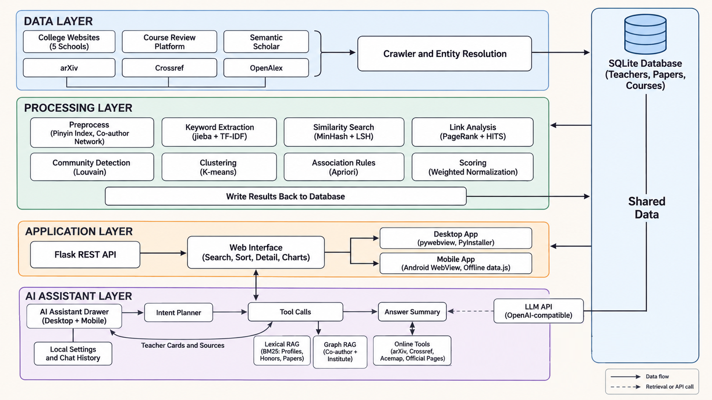
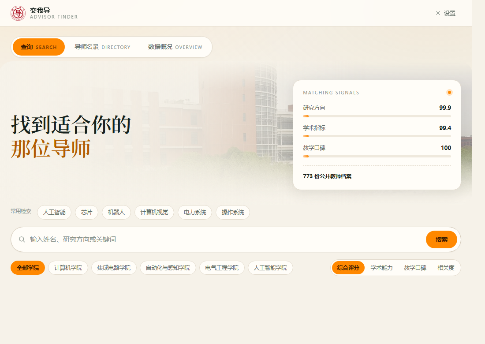
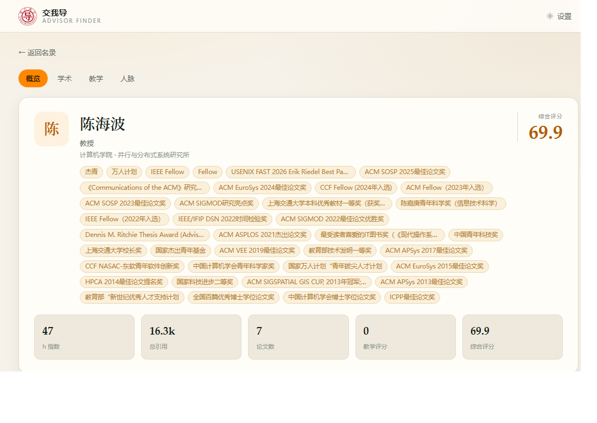
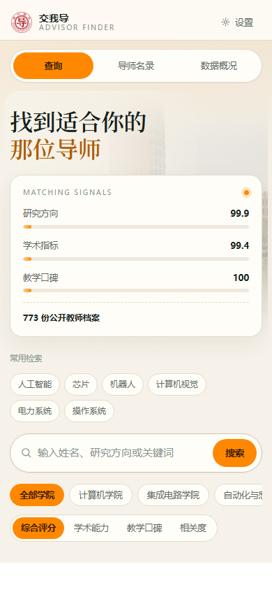
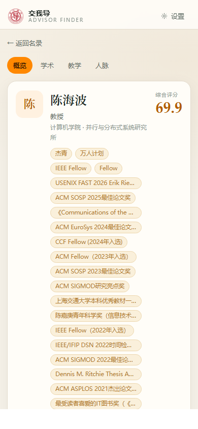

# 面向个性化导师推荐的教师画像挖掘

交我导是数据挖掘课程的大作业。项目采集上海交通大学五个学院的公开教师页面，用数据挖掘方法处理数据，并提供桌面端和安卓端应用，用于检索和比较导师。

<table>
<tr>
<td></td>
<td>

数据层从学院官网、选课社区和公开学术接口采集教师、论文、课程与评价数据，写入 SQLite。

处理层完成关键词抽取、相似检索、PageRank 与 HITS、Louvain 社区发现、K-means 聚类、Apriori 关联规则和综合评分。

应用层用 Flask 提供接口。前端使用原生 HTML、CSS、JavaScript 和 ECharts。桌面端由 pywebview 打开窗口。手机端使用 Android WebView 和随包离线数据。

</td>
</tr>
</table>

## 程序截图

桌面端：

<table>
<tr>
<td></td>
<td></td>
</tr>
</table>

手机端：

<table>
<tr>
<td></td>
<td></td>
</tr>
</table>

## 功能

- 按姓名、拼音、研究方向或关键词检索教师。
- 按学院筛选教师。
- 按综合评分、学术能力、教学口碑或相关度排序。
- 教师页包含研究方向、简介、评分构成、联系方式、能力雷达图、合作网络、相似导师、课程和论文。
- 点击研究方向标签可以打开相关检索。
- 支持浅色和深色主题，支持中文和英文界面。
- 桌面端和手机端都有 AI 助手抽屉。助手先使用本地数据库，也可以调用公开学术来源。
- 手机端可以离线使用。AI 服务为可选项。

## 项目结构

```
Project/
├─ app/                        应用层
│  ├─ app.py                   Flask 接口
│  ├─ templates/index.html     页面
│  └─ static/                  样式、脚本、图片
├─ assistant/                  AI 助手
│  ├─ agent.py                 意图规划、工具调用、回答
│  ├─ api.py                   对话接口与兜底
│  ├─ rag.py                   BM25 索引与图扩展
│  ├─ retrieval.py             本地教师检索
│  ├─ nlu.py                   问题解析
│  ├─ answer.py                规则回答
│  ├─ tools.py                 arXiv、Crossref、Acemap、官网
│  ├─ llm.py                   OpenAI 兼容客户端
│  └─ store.py                 对话记录与设置路径
├─ crawler/                    数据层
│  ├─ config.py                路径与规则
│  ├─ cs_crawler.py            计算机学院
│  ├─ college_crawler.py       其余四个学院
│  ├─ faculty_crawler.py       导师筛选
│  ├─ course_community.py      选课社区
│  ├─ scholar_client.py        Semantic Scholar
│  ├─ arxiv_client.py          arXiv 作者列表
│  ├─ crossref_client.py       Crossref 作者列表
│  └─ openalex_client.py       OpenAlex（旧缓存）
├─ processing/                 处理层
│  ├─ preprocess.py            清洗、拼音索引、合作网络
│  ├─ keyword_extract.py       jieba + TF-IDF
│  ├─ similarity_index.py      MinHash + LSH
│  ├─ ranking.py               PageRank + HITS
│  ├─ community.py             Louvain
│  ├─ clustering.py            K-means
│  ├─ association.py           Apriori
│  └─ score.py                 综合评分
├─ mobile/                     手机端
│  ├─ android/                 Android WebView 工程
│  ├─ tools/export_data.py     导出离线数据
│  └─ build_apk.ps1            APK 构建脚本
├─ scripts/                    工具脚本
│  ├─ fix_honors.py            一次性荣誉年份修复
│  └─ supplement_papers.py     补充缺失的代表论文
├─ data/
│  ├─ db/mentor.db             SQLite 数据库
│  └─ exports/                 应用需要的导出文件
├─ docs/                       截图和架构图
├─ db.py                       数据库表结构
├─ run_pipeline.py             数据层入口
├─ launcher.py                 桌面端入口
└─ environment/environment.yml Python 环境
```

`data/raw/` 是爬取缓存，已被 Git 忽略，克隆后不需要保留。

## 环境

Python 3.11。

```powershell
conda create -n dm-mentor python=3.11 -y
conda activate dm-mentor
pip install flask pywebview requests beautifulsoup4 lxml jieba pypinyin numpy pandas scikit-learn networkx mlxtend
```

## 运行桌面端

数据库和处理结果已经放在仓库中。

```powershell
python launcher.py
```

浏览器调试：

```powershell
python app/app.py
```

然后打开 http://127.0.0.1:8765

## AI 助手

助手先读取问题，调用本地检索工具，然后组织回答。教师卡片和来源链接来自工具结果。

本地检索使用 BM25 索引和图扩展。索引覆盖研究方向、关键词、荣誉、简介、论文标题、课程、研究所和学院。荣誉和研究方向的权重较高。图扩展通过合作边和同研究所关系，把与词法检索前几名接近的教师加入结果。

助手也可以调用 arXiv、Crossref、Acemap 和公开高校页面。助手不调用 OpenAlex。

两个应用都可以在设置面板填写 API 端点、模型和密钥。密钥由用户自己填写。

在 Windows 上，桌面端设置和对话记录保存在 `%LOCALAPPDATA%\JiaWoDao`，不写入仓库。其他系统使用 `~/.jiaowodao`。手机端设置保存在 WebView 的本地存储中。

没有配置密钥时，桌面端使用规则回答。

## 重新采集和处理数据

```powershell
python run_pipeline.py
python run_pipeline.py --limit 50
```

选课社区需要账号。账号从环境变量读取，不要写进代码。

```powershell
$env:COURSE_COMMUNITY_EMAIL = "你的邮箱"
$env:COURSE_COMMUNITY_PASSWORD = "你的密码"
```

处理层按以下顺序运行：

```powershell
cd processing
python preprocess.py
python keyword_extract.py
python similarity_index.py
python ranking.py
python community.py
python clustering.py
python association.py
python score.py
```

## 打包桌面端

```powershell
pyinstaller --noconfirm --onefile --windowed --name 交我导 --icon app.ico `
  --add-data "app/templates;app/templates" `
  --add-data "app/static;app/static" `
  --add-data "data/db/mentor.db;data/db" `
  --add-data "data/exports/collab_edges.csv;data/exports" `
  --add-data "data/exports/similar_pairs.json;data/exports" `
  --add-data "data/exports/association_rules.json;data/exports" `
  launcher.py
```

生成文件为 `dist/交我导.exe`。

如果启动时出现 ssl 相关错误，在命令中追加运行环境里的 DLL：

```powershell
  --add-binary "$env:CONDA_PREFIX\Library\bin\libssl-3-x64.dll;." `
  --add-binary "$env:CONDA_PREFIX\Library\bin\libcrypto-3-x64.dll;." `
  --add-binary "$env:CONDA_PREFIX\Library\bin\ffi.dll;." `
  --add-binary "$env:CONDA_PREFIX\Library\bin\liblzma.dll;." `
  --add-binary "$env:CONDA_PREFIX\Library\bin\libexpat.dll;." `
  --add-binary "$env:CONDA_PREFIX\Library\bin\libbz2.dll;."
```

## 手机端

手机端复用桌面端页面。数据导出到 `data.js` 后由 WebView 离线加载，不需要网络。

构建前设置 Android SDK 和 JDK：

```powershell
$env:ANDROID_SDK_ROOT = "你的 Android SDK 路径"
$env:JAVA_HOME = "你的 JDK 路径"
```

导出数据并构建 APK：

```powershell
python mobile/tools/export_data.py
powershell -ExecutionPolicy Bypass -File mobile/build_apk.ps1
```

生成文件为 `mobile/dist/jiaowodao-mobile.apk`。

手机端从 `https://appassets.androidplatform.net/assets/www/` 加载页面。读取顺序为 assets、res/raw、file://。

## 数据和算法

数据来源：

- 上海交通大学五个学院的公开教师主页。
- 选课社区的公开课程评价。
- Semantic Scholar 和 OpenAlex 的论文与引用数据。
- arXiv 和 Crossref 的作者列表。

没有论文记录的教师由 `scripts/supplement_papers.py` 补充代表论文。脚本读取教师姓名和研究方向，检索 OpenAlex，保留作者姓名一致、作者单位为上海交通大学、学科属于所在学院、标题或主题与研究方向相符的论文。Crossref 作为第二个来源。每条记录保存标题、年份、引用次数、发表场所、DOI 和作者。脚本同时修复旧记录中的两位年份。

当前数据库包含 773 位教师、13092 篇论文、1663 门课程。721 位教师有论文记录，其余 52 位教师没有匹配到论文。

| 模块 | 方法 | 课程知识点 |
|---|---|---|
| preprocess.py | 拼音索引、作者抽取、合作网络 | 数据清洗与集成 |
| keyword_extract.py | jieba 分词 + TF-IDF | 文本特征抽取 |
| similarity_index.py | Shingling + MinHash + LSH | 相似项检索 |
| ranking.py | PageRank + HITS | 链接分析 |
| community.py | Louvain | 社区发现 |
| clustering.py | K-means | 聚类 |
| association.py | Apriori | 关联规则 |
| score.py | 多指标加权归一化 | 综合评分 |

处理结果：

- 关键词抽取覆盖 773 人。
- 相似导师 103 对。
- 合作网络 2347 条边、676 位教师。
- Louvain 20 个社区，模块度 0.678。
- K-means 8 个主题簇。
- 关联规则 11 条。
- 综合评分覆盖 773 人。

## 综合评分

```
score = (0.10 * 论文 + 0.20 * 引用 + 0.35 * 荣誉 + 0.25 * 教学) * 100
```

每项使用全库 5% 到 95% 分位归一化：

```
norm(x) = clip((x - P5) / (P95 - P5), 0, 1)
```

| 指标 | 权重 | 说明 |
|---|---|---|
| 论文 | 0.10 | 教师论文数 |
| 引用 | 0.20 | 教师总引用 |
| 荣誉 | 0.35 | 人才称号加权和，加职称基准 |
| 教学 | 0.25 | 课程评分按评分人数加权 |

498 位教师有课程评分，平均分为 3.616。其余 275 位教师用这个平均分参与评分计算，教学评分仍显示 0，评分构成中的教学贡献用红色显示。

## 已知问题

- 研究方向缺 1 人，简介缺 14 人。
- 研究所缺 163 人，个人主页缺 216 人。
- 引用量缺 23 人，论文数缺 22 人，h 指数缺 5 人。
- 跨学院合作网络依赖作者姓名匹配，同名作者可能无法区分。
- 部分教师主页没有公开的获奖年份，荣誉只保留页面能确认的年份。
- 补充后仍有 52 位教师没有论文记录。

## 说明

项目数据来自公开网页和公开学术接口，只用于课程学习。爬取时请控制请求频率。

仓库包含公开教师资料，包括教师姓名和官网公开的联系邮箱。仓库不包含账号密码、cookie、API 密钥或访问令牌。API 密钥由用户在运行时填写，保存在仓库之外。Release 页面提供打包好的桌面端和手机端程序。
