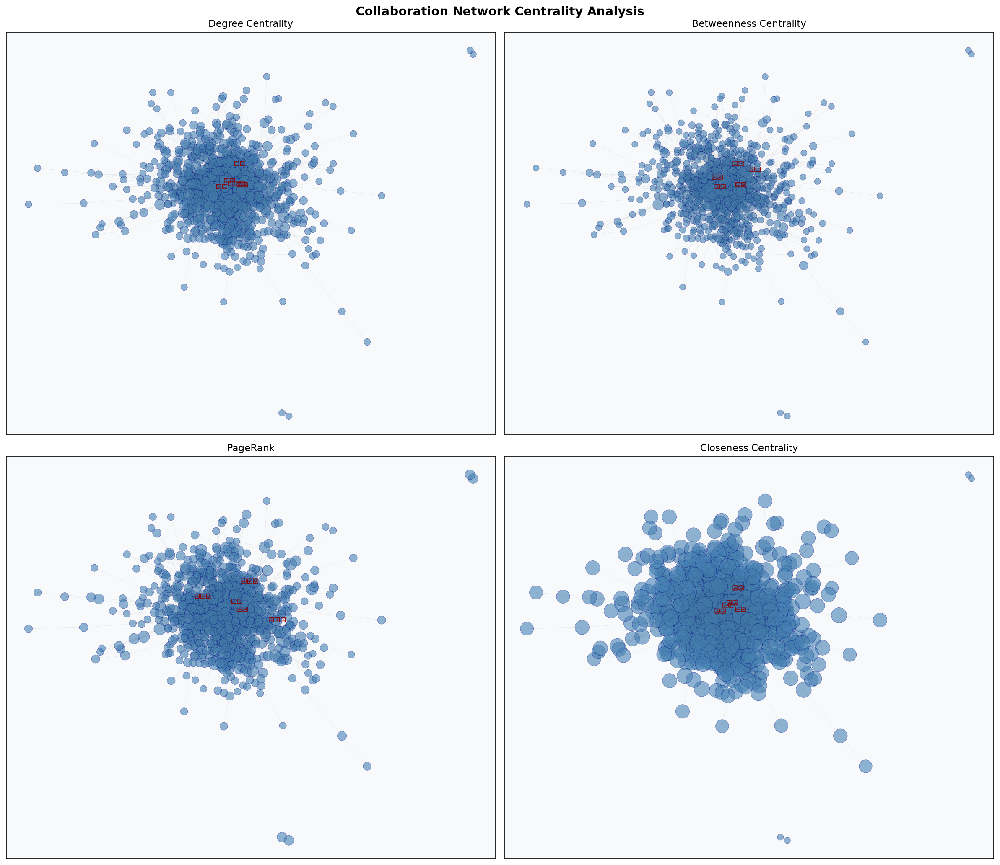

# 协作网络中心性分析

## 方法

在已有 Louvain 社区检测和 PageRank/HITS 基础上，补充多种中心性指标：

| 指标 | 公式/含义 | 识别对象 |
|------|----------|---------|
| 度中心性 | deg(v) / (n-1) | 合作最广的教师（枢纽） |
| 介数中心性 | 最短路径经过 v 的比例 | 连接不同社区的桥梁教师 |
| PageRank | 迭代加权的入链重要性 | 综合影响力（考虑邻居质量） |
| 接近中心性 | (n-1) / Σ d(v,u) | 信息传播最快的教师 |

参考：UCSD CSE 291-F Graph Mining, Brin & Page (1998) PageRank 论文。

## 网络规模

- 节点数：729 位有合作边的教师
- 边数：2938 条合作边
- 密度：0.0111
- 平均度：8.06
- 连通分量：3
- Louvain 社区数：28

## Top-15 中心性排名

### 度中心性（合作广度）

| 排名 | 姓名 | 学院 | 度中心性 |
|------|------|------|---------|
| 1 | 李浩洋 | 集成电路学院 | 0.0591 |
| 2 | 王辉 | 电气工程学院 | 0.0577 |
| 3 | 陈新 | 自动化与感知学院 | 0.0577 |
| 4 | 杨博 | 自动化与感知学院 | 0.0563 |
| 5 | 王昕 | 电气工程学院 | 0.0536 |
| 6 | 张宸 | 集成电路学院 | 0.0536 |
| 7 | 王瑞 | 计算机学院 | 0.0508 |
| 8 | 陈凯 | 集成电路学院 | 0.0508 |
| 9 | 杨旸 | 计算机学院 | 0.0508 |
| 10 | 宋利 | 集成电路学院 | 0.0481 |
| 11 | 杨旸 | 人工智能学院 | 0.0481 |
| 12 | 杨杰 | 自动化与感知学院 | 0.0467 |
| 13 | 张晗 | 自动化与感知学院 | 0.0453 |
| 14 | 张琛 | 电气工程学院 | 0.0453 |
| 15 | 李伟 | 计算机学院 | 0.044 |

### 介数中心性（桥梁效应）

| 排名 | 姓名 | 学院 | 介数中心性 |
|------|------|------|-----------|
| 1 | 陈新 | 自动化与感知学院 | 0.0455 |
| 2 | 王昕 | 电气工程学院 | 0.0426 |
| 3 | 王瑞 | 计算机学院 | 0.0424 |
| 4 | 杨博 | 自动化与感知学院 | 0.0419 |
| 5 | 王磊 | 计算机学院 | 0.038 |
| 6 | 李浩洋 | 集成电路学院 | 0.0366 |
| 7 | 李伟 | 计算机学院 | 0.0353 |
| 8 | 王辉 | 电气工程学院 | 0.0339 |
| 9 | 杨杰 | 自动化与感知学院 | 0.0299 |
| 10 | 陈凯 | 集成电路学院 | 0.029 |
| 11 | 张晗 | 自动化与感知学院 | 0.0278 |
| 12 | 张涛 | 自动化与感知学院 | 0.0265 |
| 13 | 程远 | 人工智能学院 | 0.026 |
| 14 | 杨旸 | 计算机学院 | 0.0257 |
| 15 | 张宸 | 集成电路学院 | 0.0247 |

### PageRank（综合影响力）

| 排名 | 姓名 | 学院 | PageRank |
|------|------|------|---------|
| 1 | 吕宝粮 | 计算机学院 | 0.0069 |
| 2 | 张晗 | 自动化与感知学院 | 0.0068 |
| 3 | 关新平 | 自动化与感知学院 | 0.0068 |
| 4 | 王昕 | 电气工程学院 | 0.0061 |
| 5 | 朱燕民 | 计算机学院 | 0.0059 |
| 6 | 张文军 | 集成电路学院 | 0.0059 |
| 7 | 宋利 | 集成电路学院 | 0.0057 |
| 8 | 陈彩莲 | 自动化与感知学院 | 0.0051 |
| 9 | 苏翼凯 | 集成电路学院 | 0.0049 |
| 10 | 过敏意 | 计算机学院 | 0.0048 |
| 11 | 杨杰 | 自动化与感知学院 | 0.0048 |
| 12 | 陈海波 | 计算机学院 | 0.0047 |
| 13 | 管海兵 | 计算机学院 | 0.0046 |
| 14 | 郁文贤 | 自动化与感知学院 | 0.0045 |
| 15 | 柳璐 | 电气工程学院 | 0.0045 |

### 接近中心性（信息传播速度）

| 排名 | 姓名 | 学院 | 接近中心性 |
|------|------|------|-----------|
| 1 | 陈新 | 自动化与感知学院 | 0.392 |
| 2 | 王辉 | 电气工程学院 | 0.3875 |
| 3 | 王昕 | 电气工程学院 | 0.3865 |
| 4 | 张宸 | 集成电路学院 | 0.3848 |
| 5 | 杨博 | 自动化与感知学院 | 0.3818 |
| 6 | 陈凯 | 集成电路学院 | 0.3794 |
| 7 | 李浩洋 | 集成电路学院 | 0.3782 |
| 8 | 王瑞 | 计算机学院 | 0.3776 |
| 9 | 宋利 | 集成电路学院 | 0.376 |
| 10 | 张琛 | 电气工程学院 | 0.3754 |
| 11 | 王磊 | 计算机学院 | 0.3738 |
| 12 | 杨旸 | 计算机学院 | 0.3729 |
| 13 | 张晗 | 自动化与感知学院 | 0.3715 |
| 14 | 王辉 | 集成电路学院 | 0.3704 |
| 15 | 姜山 | 电气工程学院 | 0.3702 |

## 桥梁型教师（跨社区连接）

介数中心性高且邻居分布在多个 Louvain 社区中的教师：

| 姓名 | 学院 | 介数中心性 | 连接社区数 |
|------|------|-----------|-----------|
| 陈新 | 自动化与感知学院 | 0.0455 | 18 |
| 王昕 | 电气工程学院 | 0.0426 | 16 |
| 王瑞 | 计算机学院 | 0.0424 | 16 |
| 杨博 | 自动化与感知学院 | 0.0419 | 16 |
| 王磊 | 计算机学院 | 0.038 | 13 |
| 李浩洋 | 集成电路学院 | 0.0366 | 16 |
| 李伟 | 计算机学院 | 0.0353 | 18 |
| 王辉 | 电气工程学院 | 0.0339 | 17 |
| 杨杰 | 自动化与感知学院 | 0.0299 | 13 |
| 陈凯 | 集成电路学院 | 0.029 | 18 |

## 分析结论

1. **枢纽教师**（度中心性 Top）：合作网络中最活跃，是资源汇聚点；推荐时适合需要广泛合作资源的学生。
2. **桥梁教师**（介数中心性 Top）：连接不同研究方向/社区，适合希望跨方向拓展的学生。
3. **影响力教师**（PageRank Top）：不仅自身合作多，且合作的对象本身也重要，综合学术影响力强。
4. **高效传播教师**（接近中心性 Top）：在合作网络中距离其他人最近，信息/资源流通效率高。

## 可视化

