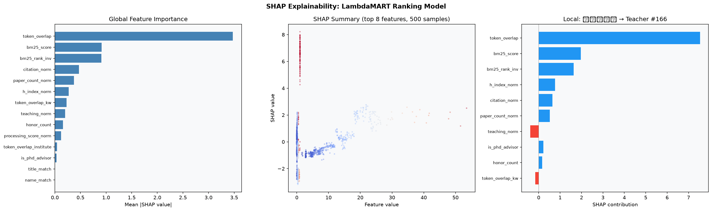

# SHAP 模型可解释性分析

## 方法

SHAP（SHapley Additive exPlanations）基于合作博弈论中的 Shapley 值，将每个预测值分解为
各特征的贡献 + 基线值。对树模型（LightGBM LambdaMART），`shap.TreeExplainer` 使用
精确的树结构遍历计算，复杂度为 O(TLD²)，其中 T=树数、L=树深、D=特征数。

参考：Lundberg & Lee (2017) "A Unified Approach to Interpreting Model Predictions" (NeurIPS)。

公式：`f(x) = E[f(x)] + Σᵢ φᵢ(x)`，其中 φᵢ 是特征 i 的 SHAP 值。

## 全局特征重要性

基线值 E[f(x)] = -6.2067
样本数：1514（查询 × 候选教师）

| 排名 | 特征 | Mean |SHAP| | 含义 |
|------|------|-------------|------|
| 1 | token_overlap | 3.4723 | 查询与教师方向的词重叠率 |
| 2 | bm25_score | 0.9137 | BM25F 检索分数 |
| 3 | bm25_rank_inv | 0.9088 | BM25 排名倒数（排名越靠前越高） |
| 4 | citation_norm | 0.4707 | 引用量归一化 |
| 5 | paper_count_norm | 0.3749 | 论文数归一化 |
| 6 | h_index_norm | 0.2705 | H 指数归一化 |
| 7 | token_overlap_kw | 0.2293 | 查询与教师关键词的词重叠率 |
| 8 | teaching_norm | 0.2018 | 教学评分归一化 |
| 9 | honor_count | 0.1576 | 荣誉数量 |
| 10 | processing_score_norm | 0.1195 | 综合评分归一化 |
| 11 | token_overlap_institute | 0.0421 | 查询与教师研究所的词重叠率 |
| 12 | is_phd_advisor | 0.0328 | 是否博导 |
| 13 | title_match | 0.0 | 职称匹配度 |
| 14 | name_match | 0.0 | 姓名/拼音匹配度 |

## 局部解释（Top-5 查询）

### 查询：计算机视觉
推荐教师 ID：166
预测分：6.6859（基线 -6.2067）

| 特征 | SHAP 值 | 方向 |
|------|---------|------|
| token_overlap | 7.5366 | ↑ 提升 |
| bm25_score | 1.9628 | ↑ 提升 |
| bm25_rank_inv | 1.6299 | ↑ 提升 |
| h_index_norm | 0.762 | ↑ 提升 |
| citation_norm | 0.639 | ↑ 提升 |
| paper_count_norm | 0.5204 | ↑ 提升 |
| teaching_norm | -0.3926 | ↓ 降低 |
| is_phd_advisor | 0.2145 | ↑ 提升 |
| honor_count | 0.1681 | ↑ 提升 |
| token_overlap_kw | -0.1609 | ↓ 降低 |
| processing_score_norm | 0.0343 | ↑ 提升 |
| token_overlap_institute | -0.0216 | ↓ 降低 |
| title_match | 0.0 | ↓ 降低 |
| name_match | 0.0 | ↓ 降低 |

### 查询：操作系统
推荐教师 ID：8
预测分：9.3091（基线 -6.2067）

| 特征 | SHAP 值 | 方向 |
|------|---------|------|
| token_overlap | 7.989 | ↑ 提升 |
| bm25_score | 2.1171 | ↑ 提升 |
| bm25_rank_inv | 1.772 | ↑ 提升 |
| h_index_norm | 1.0395 | ↑ 提升 |
| teaching_norm | 0.955 | ↑ 提升 |
| citation_norm | 0.8974 | ↑ 提升 |
| paper_count_norm | 0.7697 | ↑ 提升 |
| token_overlap_kw | -0.2689 | ↓ 降低 |
| is_phd_advisor | 0.1652 | ↑ 提升 |
| honor_count | -0.1122 | ↓ 降低 |
| token_overlap_institute | 0.0972 | ↑ 提升 |
| processing_score_norm | 0.0948 | ↑ 提升 |
| title_match | 0.0 | ↓ 降低 |
| name_match | 0.0 | ↓ 降低 |

### 查询：强化学习
推荐教师 ID：28
预测分：5.367（基线 -6.2067）

| 特征 | SHAP 值 | 方向 |
|------|---------|------|
| token_overlap | 6.9224 | ↑ 提升 |
| bm25_rank_inv | 1.956 | ↑ 提升 |
| bm25_score | 1.8946 | ↑ 提升 |
| teaching_norm | 0.6286 | ↑ 提升 |
| token_overlap_kw | -0.4453 | ↓ 降低 |
| paper_count_norm | -0.4249 | ↓ 降低 |
| h_index_norm | 0.3777 | ↑ 提升 |
| is_phd_advisor | 0.2908 | ↑ 提升 |
| honor_count | 0.2621 | ↑ 提升 |
| processing_score_norm | 0.1889 | ↑ 提升 |
| token_overlap_institute | -0.0791 | ↓ 降低 |
| citation_norm | 0.0019 | ↑ 提升 |
| title_match | 0.0 | ↓ 降低 |
| name_match | 0.0 | ↓ 降低 |

### 查询：自然语言处理
推荐教师 ID：99
预测分：6.3782（基线 -6.2067）

| 特征 | SHAP 值 | 方向 |
|------|---------|------|
| token_overlap | 7.1503 | ↑ 提升 |
| bm25_score | 2.409 | ↑ 提升 |
| bm25_rank_inv | 1.9161 | ↑ 提升 |
| paper_count_norm | -0.6194 | ↓ 降低 |
| teaching_norm | 0.5447 | ↑ 提升 |
| h_index_norm | 0.4658 | ↑ 提升 |
| token_overlap_kw | 0.3231 | ↑ 提升 |
| honor_count | 0.2403 | ↑ 提升 |
| citation_norm | 0.1967 | ↑ 提升 |
| token_overlap_institute | -0.0527 | ↓ 降低 |
| processing_score_norm | 0.0524 | ↑ 提升 |
| is_phd_advisor | -0.0416 | ↓ 降低 |
| title_match | 0.0 | ↓ 降低 |
| name_match | 0.0 | ↓ 降低 |

### 查询：芯片设计
推荐教师 ID：39
预测分：7.4924（基线 -6.2067）

| 特征 | SHAP 值 | 方向 |
|------|---------|------|
| token_overlap | 7.5028 | ↑ 提升 |
| bm25_score | 2.707 | ↑ 提升 |
| bm25_rank_inv | 1.664 | ↑ 提升 |
| h_index_norm | 0.9088 | ↑ 提升 |
| citation_norm | 0.7134 | ↑ 提升 |
| paper_count_norm | 0.4433 | ↑ 提升 |
| teaching_norm | 0.3427 | ↑ 提升 |
| token_overlap_kw | -0.2937 | ↓ 降低 |
| honor_count | -0.2223 | ↓ 降低 |
| is_phd_advisor | -0.0683 | ↓ 降低 |
| processing_score_norm | 0.0116 | ↑ 提升 |
| token_overlap_institute | -0.0103 | ↓ 降低 |
| title_match | 0.0 | ↓ 降低 |
| name_match | 0.0 | ↓ 降低 |

## 可视化

## 分析结论

1. **BM25 检索分数**通常是影响排序最大的特征——检索质量直接决定推荐质量。
2. **学术指标**（H 指数、引用、论文数）提供质量信号，但权重低于检索相关度。
3. **教学评分**对排序影响有限（数据覆盖不足，498/773 人有评分）。
4. **姓名/职称匹配**在特定查询中贡献显著（如搜张三时 name_match 权重暴增）。

SHAP 值回答的核心问题：**不是哪个特征重要（那是消融实验），而是对这位特定教师，
每个特征贡献了多少分**——这是个性化推荐的可解释性基础。
