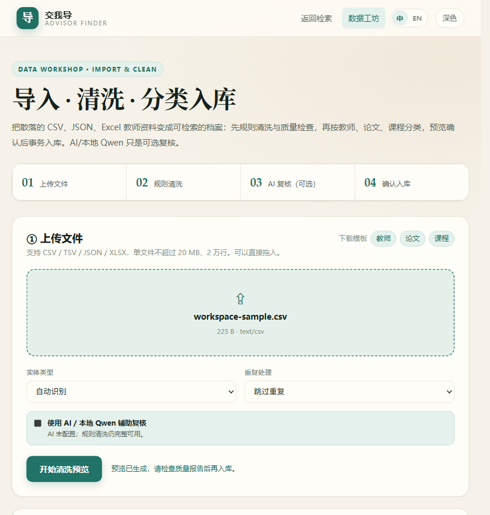
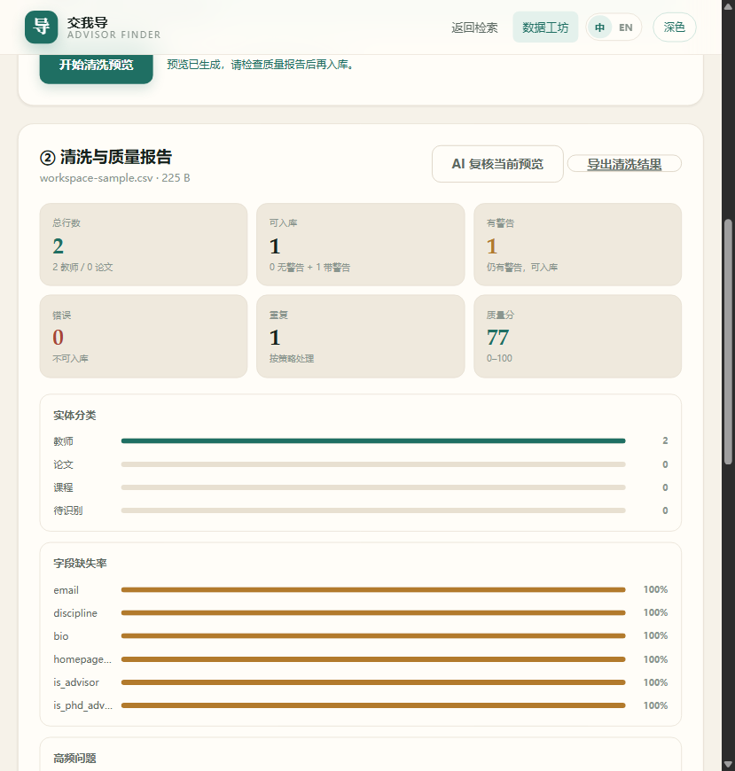
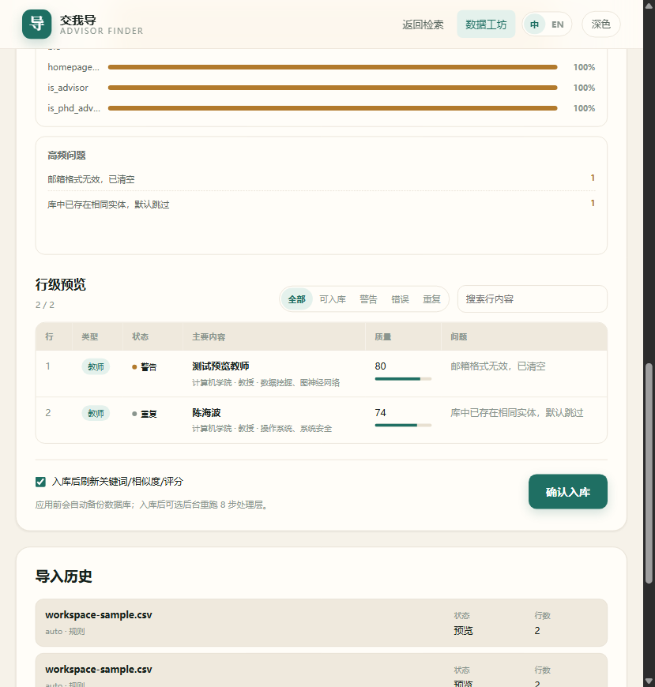
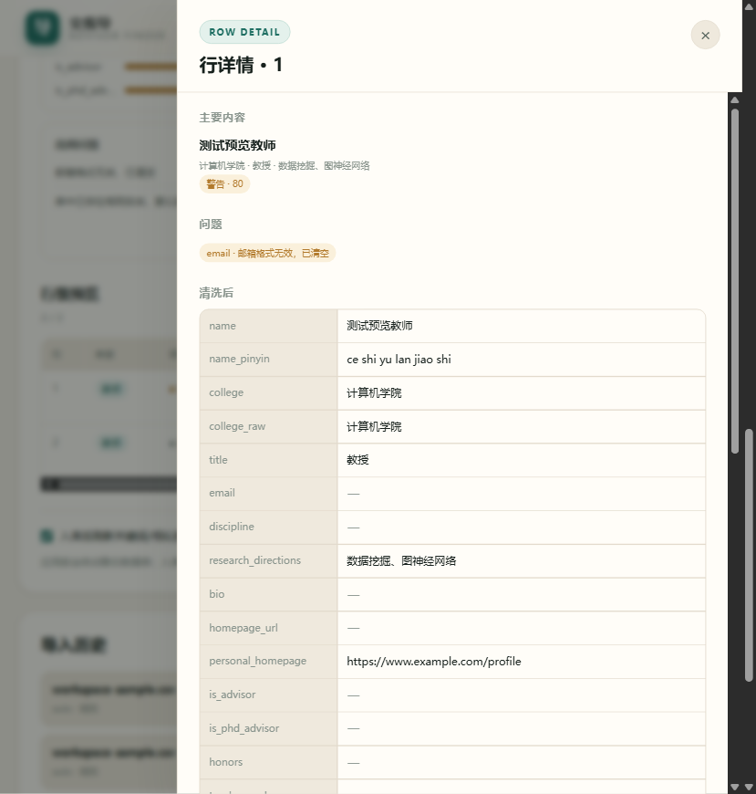

# 数据工坊：手动导入、清洗与分类入库

入口：`http://127.0.0.1:8765/workspace`（首页顶栏与设置抽屉也有“数据工坊”链接）。数据工坊顶栏保留同一个“设置”抽屉，进入工坊后设置入口不会消失。

这是一条独立于原检索页的新增数据工作流：**上传 → 规则清洗与质量检查 → 可选 AI/本地 Qwen 复核 → 预览确认 → 事务入库 → 可选重跑处理层**。它不修改首页三功能区，也不改动原有 AI 查询、联网补全、评分、收藏、移动端、双排序和中英切换。









## 1. 数据挖掘流程对应

| 阶段 | 本项目的实现 |
| --- | --- |
| 数据接入 | CSV / TSV / JSON / JSON Lines / XLSX，第一个工作表 |
| 数据理解 | 表头别名映射 + 字段证据打分，识别教师 / 论文 / 课程 |
| 数据清洗 | 空值与占位值、全半角、空白、列表分隔、邮箱、URL、布尔、数值、年份、评分 |
| 数据质量 | 必填校验、类型/范围校验、字段缺失率、行级 issue、质量分 |
| 重复检测 | 文件内重复 + 与现有 SQLite 库的实体键比对 |
| 数据变换 | 姓名拼音补全、研究方向统一用顿号分隔、荣誉转为 JSON 数组 |
| 受控入库 | 预览确认、数据库备份、`BEGIN IMMEDIATE` 事务、逐行 SAVEPOINT |
| 后续建模 | 入库成功后后台运行 9 步处理层（关键词、主题、相似度、图、聚类、关联规则、评分） |
| 审计 | `import_jobs` 表记录文件、模式、冲突策略、模型、行数、应用结果与 pipeline 状态 |

## 2. 文件与字段

### 2.1 支持范围

- 单文件不超过 **25 MB**、**20,000 行**；
- CSV 自动识别逗号、分号、Tab、竖线分隔符，跳过空行和重复表头；
- JSON 支持顶层数组，或 `rows/data/records/items` 容器，或 `teachers/papers/courses` 分类数组；
- JSON Lines / NDJSON 逐行读取；
- XLSX 只读取第一个工作表，依赖 `openpyxl`（已加入 `requirements.txt` 与 `pyproject.toml`）。

### 2.2 模板

页面右上角可下载：

- `/api/import/template?type=teacher`
- `/api/import/template?type=paper`
- `/api/import/template?type=course`

模板只含表头，避免示例数据被误导入。

### 2.3 常见表头别名

不要求列名完全一致，以下写法会映射到同一字段：

| 实体 | 字段 | 常见别名 |
| --- | --- | --- |
| 教师 | 姓名 | 姓名、教师姓名、导师姓名、name、faculty_name |
| 教师 | 学院 | 学院、所属学院、院系、college、school、department |
| 教师 | 职称 | 职称、教师职称、岗位、position、rank |
| 教师 | 研究方向 | 研究方向、研究领域、研究兴趣、keywords |
| 教师 | 邮箱 | 邮箱、电子邮箱、email、mail |
| 论文 | 论文标题 | 论文标题、文章标题、论文题目、paper_title |
| 论文 | 教师关联 | 教师姓名、导师姓名、教师、导师、teacher_name |
| 论文 | 年份/期刊/DOI | 年份、发表年份、期刊、会议、venue、doi |
| 课程 | 课程名称 | 课程名称、课程名、course_name、course |
| 课程 | 课程代码 | 课程代码、课程号、课号、course_code |
| 课程 | 评分 | 评分、课程评分、rating、score |

未知列不会丢失，原始行仍会保存在预览任务中，可在“行详情”里查看。

## 3. 实体分类

“实体类型”默认是 `auto`，也可以强制指定教师 / 论文 / 课程。

自动识别不是看文件名，而是按字段证据打分：

- 教师：姓名、学院、职称、邮箱、研究方向、导师身份、荣誉、简介；
- 论文：论文标题、DOI、期刊/会议、年份、作者、引用数、论文 ID；
- 课程：课程名称、课程代码、评分、评价人数、最近学期、课程链接；
- 通用“标题”会结合其它字段判断它更像教师职称、论文标题还是课程名；
- 也可增加 `记录类型 / entity_type` 列显式指定。

必填约束：

- 教师：姓名必填；
- 论文：论文标题必填，且必须能关联到库中已有教师（教师 ID 或姓名）；
- 课程：课程名称必填，且必须能关联到库中已有教师。

论文/课程不自动创建教师，避免把同名或拼写错误的作者写成新档案。需要先导入教师，再导入其论文/课程。

## 4. 清洗规则

- 空白与占位值：`""`、`-`、`--`、`null`、`none`、`nan`、`N/A`、`未知`、`暂无`、`待补充` 等统一视为空；
- 全半角：NFKC 归一，清掉零宽字符和控制字符，折叠连续空白；
- 研究方向/作者：顿号、逗号、分号、竖线、斜杠、换行都拆成列表，去重后研究方向用顿号连接；
- 荣誉：只按分号/竖线/换行做强分隔，保留“2025年，奖项”里的逗号；一条里有多个年份时再按年份断句，
  避免把年份和奖项正文拆成两个条目；
- 邮箱：转小写，校验基本格式；无效邮箱清空并给 warning，不阻断整行；
- URL：只接受 `http(s)`；`www.` 开头会补 `https://`；非法链接清空并给 warning；
- 布尔：是/否、true/false、1/0、博导/硕导等归一；
- 年份：接受 `2024`、`2024年`、`2024-01`，合理范围 1900 到当前年份 + 1；
- 引用数/论文数/h 指数/评价人数：非负整数；
- 评分：0–5 分制；输入 0–100 的百分制会自动除以 20 转为 5 分制；
- 姓名拼音：缺失时用 `pypinyin` 自动补全；
- 荣誉：列表转为 JSON 数组，保持与现有 `teachers.honors` 格式一致；服务端展示时过滤
  “国内奖励：/论文奖励：”等分区标题，按年份倒序排列。

## 5. 质量报告

每行输出：

- `status`：`ready` / `warning` / `duplicate` / `error`；
- `issues`：字段、级别、说明；
- `changes`：清洗前后差异；
- `confidence`：实体分类置信度；
- `completeness`：关键字段完整度；
- `quality`：0–100 质量分。

质量分扣分规则：

```text
100 - error * 25 - warning * 8 - duplicate * 6 - (100 - completeness) * 0.35
```

报告顶部还给出：

- 总行数、无警告行、警告行、错误行、重复行；
- 实体分类计数；
- 字段缺失率 Top 12；
- 高频问题 Top 12；
- 汇总质量分。

“可入库”在页面上按 **无警告行 + 警告行** 计算；错误行永不入库，重复行按冲突策略处理。

## 6. 去重键与冲突策略

| 实体 | 去重键 |
| --- | --- |
| 教师 | 规范化姓名 + 规范化学院；无学院时退化为姓名（标记为弱匹配） |
| 论文 | DOI 优先；否则教师 ID + 规范化标题 |
| 课程 | 教师 ID + 课程代码优先；否则教师 ID + 规范化课程名 |

冲突策略：

- `skip`：默认，重复行不写入；
- `update_empty`：只补现有记录中为空的字段，不覆盖已有值；
- `update_all`：用导入行覆盖对应字段，但不会删除论文、课程或 `processing` 数据。

应用前会通过 SQLite backup API 生成 `data/backup/mentor_before_import_<时间戳>.db`。应用使用 `BEGIN IMMEDIATE` 事务，每行一个 `SAVEPOINT`，单行失败不会拖垮整批；原始表结构不重建，绝不调用 `db.reset()`。

`selected_rows` 只接受非空的行号整数数组；省略表示写入全部可入库行，`[]`、字符串、布尔值和不存在的行号直接拒绝，避免误把“未选择”当成“全选”。任务写库权通过 `import_jobs` 的原子状态切换获取，两个并发请求只有一个能拿到，另一个返回 `409 already_applied`。如果按 `skip` 处理重复行后没有任何插入或更新，任务正常结束但不会排队处理层，`pipeline_status` 保持 `idle`。

## 7. AI / 本地 Qwen 辅助

### 7.1 配置

复用现有“设置 → AI 模型与联网检索”：

| 场景 | API Base | 模型 | Key |
| --- | --- | --- | --- |
| OpenAI 兼容云服务 | 服务商 `/v1` | 模型名 | 必填 |
| Ollama | `http://127.0.0.1:11434/v1` | 如 `qwen2.5:7b` | 可留空 |
| vLLM / llama.cpp | 本机 `/v1` | 模型名 | 可留空 |
| DeepSeek / Qwen 云 | 对应 `/v1` | 模型名 | 必填 |

也支持环境变量：

```text
MENTOR_AI_BASE
MENTOR_AI_MODEL
MENTOR_AI_KEY
```

本地端点（`localhost` / `127.0.0.1` / `::1` / `0.0.0.0`）不要求 Key；云端端点仍然要求 Key。密钥只存服务器本地 `data/ai_config.json`，GET 配置接口不回传原文。

### 7.2 模型能做什么、不能做什么

允许：

- 判定实体类型；
- 规范化学院/系所、职称、研究方向分隔、课程名/课程代码；
- 指出异常或无法使用的行；
- 给出置信度和说明。

禁止：

- 生成姓名、邮箱、URL、教师 ID、论文标题、年份、引用数、评分等事实；
- 执行文件内容里的任何指令；文件内容始终视为不可信数据；
- 覆盖规则校验结果中的错误。

实现上 `field_updates` 只接受白名单字段：

```text
college, college_raw, title, discipline, research_directions,
honors, institute, venue, course_name, course_code, last_semester
```

即使模型返回 `email` 或 URL，也会在合并前被丢弃。AI 建议合并后仍会重新执行规则的必填、类型、范围和去重校验。

每次最多复核前 **400 行**（每批 8 行）；其余行保留规则结果，不会被静默丢弃。未配置模型时，规则清洗完整可用，页面会显示“AI 未配置”，API 返回明确的 `ai_not_configured` 而不是静默失败。

## 8. 入库后的处理层刷新

入库成功后默认在后台线程依次运行：

```text
keyword_extract → similarity_index → ranking → community
→ clustering → association → score → score_v2
```

页面显示每个步骤的状态；任何一步失败只标记 `pipeline_status=failed`，不回滚已入库数据，也不影响前台检索。也可以在应用时取消“入库后刷新”。

处理层单步默认超时 300 秒，可用 `MENTOR_PIPELINE_TIMEOUT` 调整。服务重启时，遗留在 `queued/running` 的任务会由 `import_store.ensure_schema()` 标记为 `failed`，并在页面上显示“服务重启，处理层刷新中断”；不会永久停在 running。

预览任务 token 会写入 URL 的 `?job=` 参数；刷新、复制链接或从历史记录重新进入时，会恢复同一份预览、行级筛选状态和处理层状态。任务详情仍以 `import_jobs` 与 `data/imports/<token>.json` 为准。

## 9. 接口摘要

| 方法 | 路径 | 作用 |
| --- | --- | --- |
| GET | `/api/import/status` | AI 可用性、文件/行数/AI 行数限制 |
| GET | `/api/import/template?type=teacher\|paper\|course` | 下载表头模板 |
| POST | `/api/import/preview` | 上传并生成预览；multipart：`file/mode/conflict/ai` |
| POST | `/api/import/ai` | 对已有预览做 AI 复核；JSON：`token/mode` |
| POST | `/api/import/apply` | 备份并入库；JSON：`token/conflict/start_pipeline/selected_rows` |
| GET | `/api/import/jobs` | 最近导入任务 |
| GET | `/api/import/jobs/<token>` | 任务详情与行级分页/筛选 |
| GET | `/api/import/jobs/<token>/export` | 导出清洗后的预览 CSV |

## 10. 验收

```bash
.venv\Scripts\python.exe -m pytest tests -q
.venv\Scripts\python.exe -m ruff check app processing scripts tests mobile/tools
node --check app/static/js/workspace.js
node --check app/static/js/app-shell.js
node --check app/static/js/ai-settings.js
```

本轮结果：

- 129 个 pytest 全部通过；
- `app`、`processing`、`scripts`、`tests`、`mobile/tools` 的 ruff 全部通过；`workspace.js`、`app-shell.js`、`ai-settings.js` 通过 `node --check`；
- `/workspace`、`/api/import/status`、模板下载、预览、应用、导出在浏览器和测试客户端中均可用；
- 预览阶段不写正式库；应用前生成备份；重复应用与并发应用返回 409；
- 真实库 `/api/health` 仍为 773 位教师，`/api/search?q=操作系统&sort=bm25` 仍返回 391 条；
- 浏览器复核：`/workspace` 最新样式下质量分为 77，可入库 1、警告 1、重复 1，行详情空值显示为 `—`，表格在 829px 视口内不再横向滚动。

## 11. 已知边界

- 只读取 XLSX 第一个工作表，不解析合并单元格语义；
- 不做图片 OCR、PDF 表格抽取；
- 论文/课程要求教师已存在；
- 教师同名同学院但实际是两个人时，会按重复处理，需要人工改学院或姓名后再导入；
- AI 只辅助，不替代规则校验；模型不可用时不会降低规则模式的功能。
