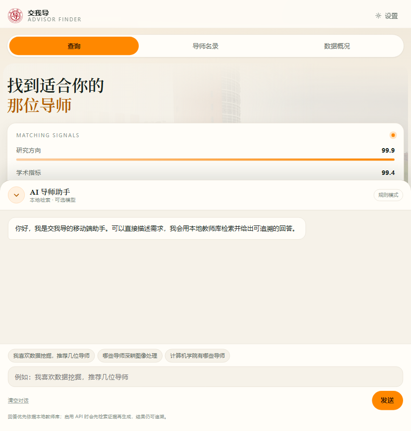
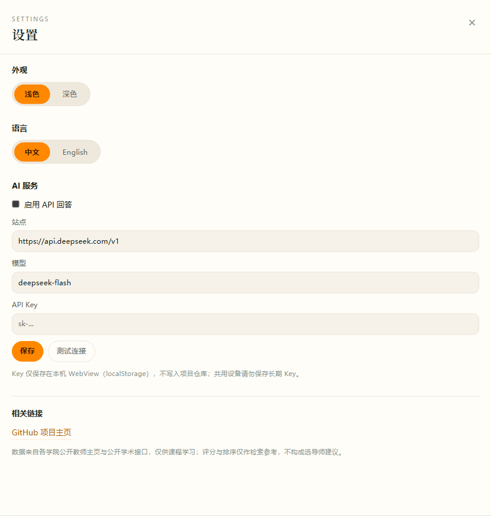

# 移动端 AI 助手与 APK 打包（v2.7）

本文记录 `AdvisorFinder-mobile.apk.1` 相比副本原移动端的额外能力、合并方式、加固点、
使用说明与 APK 构建流程。对应移动端版本 **2.7**（versionCode 18）；桌面/接口版本为
**v2.7.0**。





## 1. 对比结论

`AdvisorFinder-mobile.apk.1` 不是“另一套页面”，而是“当前移动端 + 移动 AI 助手”的增量版。
APK 的 `assets/www` 与副本原 `mobile/android/assets/www` 逐文件对比后，APK 多出的内容为：

| 文件 | APK 增量 |
| --- | --- |
| `index.html` | 底部可拖拽 AI 抽屉、建议 chips、输入/发送/清空、免责说明；设置里的“AI 服务”配置组 |
| `js/mobile-ai.js` | 新增，约 1,200 行：本地意图识别、教师库检索、证据卡、可选 API |
| `mobile.css` | AI 抽屉、气泡、卡片、来源、输入区、设置字段样式 |
| `js/i18n.js` | `ai.*`、`settings.ai.*` 中英词条，补电气工程学院英文名 |
| `js/app.js` | 仅多一行：动态渲染后调用 `MobileAI.refresh()` |
| `js/mobile-chrome.js` | 仅多 6 行：Android 返回键优先收起 AI 抽屉 |

`data.js` 已在 2026-11-26 整合后重新导出：773 位教师、15,083 篇论文（旧版为
11,093 篇），并保留 `name_pinyin` 字段；`echarts.min.js`、图片、`mobile-api.js`、
`mobile-env.js` 的文本内容没有实质差异，未用 APK 覆盖。合并前的 5 个被覆盖文件备份在
`%TEMP%\advisor-mobile-before-ai`。

APK 的 AI **不是端侧 Qwen 推理**。`index.html` 里“Qwen3-0.6B 通过 wllama”的注释是旧文案，
APK 内没有 wllama 库，也没有模型权重。实际实现是：

1. 本地规则解析意图（问候、方向推荐、教师查询、对比、实验室、近期成果、专家等）；
2. 在离线 `data.js` 的 773 位教师、论文、研究所、合作网络中检索；
   查询缩写 `ML / CV / NLP / LLM / GNN` 会扩展到库内中文写法，短英文别名按词边界匹配，
   避免 `html` 命中 `ml`、`said` 命中 `ai`；
3. 用模板回答，附“研究方向命中/关键词命中/相关论文”等证据与可点击档案卡；
4. 可选调用 OpenAI 兼容 `chat/completions`：先把本地 RAG 证据放进系统提示，要求模型
   “只能依据证据回答，不得编造”，失败时回退本地规则回答。

因此文档与界面都按“本地检索 + 可选模型”描述，不写“端侧小模型”。

## 2. 已融入副本的内容

- 完整合入 APK 的 AI 抽屉、设置组、样式、中英词条与返回键逻辑；
- 保留副本原移动端的真实校园封面、名录/档案、双语、离线数据与 `/mobile/` 预览路由；
- 新增 `web_ai` 的 `res/raw` 兜底：`build_apk.ps1` 会把 `js/mobile-ai.js` 复制为
  `res/raw/web_ai`，`MainActivity.rawIdFor()` 增加
  `www/js/mobile-ai.js -> R.raw.web_ai` 映射，避免 assets 被剥离的设备上 AI 抽屉失效；
- 移动静态资源加 `?v=20261123v27` 版本号，避免 WebView/浏览器继续使用旧 `i18n.js`、
  `mobile.css`、`data.js`；`MainActivity` 读取资源时会去掉 query，不影响 APK 内资源映射；
- 打开设置时先收起 AI 抽屉，避免设置抽屉与 AI 抽屉叠加后返回键优先级混乱。

### 2.1 v2.5–v2.7 同步追加

- **英文/拼音姓名检索**：`NAME_KEYS` 把 `name_pinyin` 拆成 `yu yong` 与 `yong yu` 两种顺序，
  并在中文姓名未命中时按 ASCII token 匹配；`LOOKUP` 增加 `introduce`、`who is`、`about`。
- **抽屉触控修复**：切态/拖动时复位 `sheet.scrollTop`，避免内部滚动把顶栏顶出屏幕；
  收起时若输入框有焦点则 `blur()`，避免软键盘把抽屉顶飞；补 `lostpointercapture`，
  防止拖拽状态残留。
- **不再展开即自动聚焦输入框**：移动端展开时不再主动弹软键盘；桌面聊天抽屉仍保留聚焦。
- **数据同步**：`data.js` 在整合后重新导出，论文数为 15,083，教师仍为 773。
- **版本号**：Android `versionCode 18 / versionName 2.7`，构建脚本同步。

## 3. 在 APK 基础上做的加固

APK 原实现可用，但有几处工程/安全问题，本轮一并修正：

| 问题 | 处理 |
| --- | --- |
| 来源链接直接使用数据库里的 URL | 只接受 `http://` / `https://`，其他协议不渲染 |
| 远程 API 允许 `http://`，Key 可能明文传输 | 远程站点强制 `https://`；本机端点允许 `http://` |
| 本机模型也必须填 Key | 本机端点（`localhost`、`127.0.0.1`、`::1`、`0.0.0.0`、`10.0.2.2`、`*.local`）可留空 Key |
| 保存后状态直接显示“连接成功” | 改为“已保存配置（尚未测试）”；只有“测试连接”成功才显示“连接成功” |
| 请求固定带 `Authorization: Bearer` 和 DeepSeek 专用 `thinking` 参数 | 无 Key 时不发 Authorization；移除 `thinking`，提高 OpenAI 兼容性 |
| 请求无超时，模型卡住时按钮一直禁用 | 30 秒 `AbortController` 超时，失败自动回退本地规则 |
| 无 RAG 证据时也提示“API 不可用” | 区分“跳过 API”与“API 调用失败”，只在真正失败时提示 |
| 设置页切换语言后状态/占位符仍是旧语言 | 状态键与占位符随 `MobileAI.refresh()` 重新翻译 |
| 模型输出可能进入 `innerHTML` | 消息、卡片、来源全部用 `textContent`/DOM 节点渲染 |
| Key 掩码过短时几乎暴露全文 | 长度不足 12 位时统一显示 `••••` |

## 4. 使用说明

### 4.1 桌面预览

```powershell
run.bat
# 浏览器打开 http://127.0.0.1:8765/mobile/
```

`/mobile/` 与 APK 使用同一套 `mobile/android/assets/www`，可直接验证抽屉、建议 chips、
教师卡、设置与中英切换。首次打开若仍是旧界面，按 `Ctrl+F5` 强制刷新。

### 4.2 抽屉操作

- 底部 `AI 导师助手` 是折叠态（peek，60px）；
- 点击箭头或拖动把手可展开到半屏/全屏；
- 再点箭头、按 `Esc` 或 Android 返回键收起；
- 点建议 chips 直接提问；也可输入“我喜欢数据挖掘，推荐几位导师”
  “哪些导师深耕图像处理”“计算机学院有哪些导师”；
- 回答里的教师卡可打开档案；来源只显示公开主页；
- “清空对话”只清当前设备上的对话记录，不清教师库。

### 4.3 配置云端模型

打开「设置 → AI 服务」：

| 字段 | 示例 | 说明 |
| --- | --- | --- |
| 启用 API 回答 | 勾选 | 不勾选时只用本地规则检索 |
| 站点 | `https://api.deepseek.com/v1` | OpenAI 兼容 Base URL；远程必须 HTTPS |
| 模型 | `deepseek-flash` | 需支持 `/chat/completions` |
| API Key | `sk-...` | 远程必填；本机端点可留空 |
| 保存 | — | 写入本机 WebView 的 `localStorage` |
| 测试连接 | — | 发一条“只回复：连接成功”的最小请求 |

默认值沿用 APK：`https://api.deepseek.com/v1` / `deepseek-flash`。也支持任何 OpenAI 兼容
服务；只要服务端允许 WebView 的跨域请求（CORS）。如果供应商禁止浏览器直连，需要自建
服务端转发，不能把 Key 直接放在手机端硬扛。

### 4.4 本机模型

桌面 `/mobile/` 预览可以直接连本机 Ollama：

```powershell
ollama serve
ollama pull qwen2.5:7b
# 设置里填：
# 站点  http://127.0.0.1:11434/v1
# 模型  qwen2.5:7b
# Key   留空
```

**APK 内不要直接填 `http://127.0.0.1:11434/v1`。** APK 页面运行在
`https://appassets.androidplatform.net/assets/www/`，`MainActivity` 设置了
`MIXED_CONTENT_NEVER_ALLOW`，HTTPS 页面请求明文 HTTP 会被 WebView 拦截。手机端要接本机
模型，需要给模型套 HTTPS（可信证书或受信任的内网证书），或改走云端 HTTPS 服务；局域网
端点同样建议 HTTPS。不要为了省事把 `MIXED_CONTENT_ALWAYS_ALLOW` 打开。

### 4.5 Key 与隐私

- Key 只存在本机 WebView 的 `localStorage`（`mobile_ai_settings`），不写入仓库、不上传服务器；
- 卸载应用/清除应用数据会删除 Key 与对话；
- 设置页只显示 `前5位…后4位`，不直接回显完整 Key；
- 共用设备不要保存长期 Key；课程演示建议用限额 Key，演示后清空；
- 对话历史存在 `mobile_ai_history`，最多保留 40 条；“清空对话”只清该记录；
- 移动端回答仍以本地教师库为主；模型只拿本地证据，不应编造薪资、招生名额、实验室成员等
  本地没有的字段。

## 5. APK 构建

### 5.1 前置条件

- JDK 17 或 21，设置 `JAVA_HOME`；
- Android SDK，设置 `ANDROID_SDK_ROOT` 或 `ANDROID_HOME`；
- SDK 内至少有一个 `build-tools` 和一个 `platforms`（脚本取名称排序最新的一项）；
- 不需要 Gradle，不联网拉依赖。

```powershell
$env:ANDROID_SDK_ROOT = "C:\Users\<你>\AppData\Local\Android\Sdk"
$env:JAVA_HOME = "C:\Program Files\Eclipse Adoptium\jdk-17..."
```

### 5.2 打包

```powershell
cd "D:\homework\data mining\大作业\Mining-Faculty-Profiles-for-Personalized-Advisor-Recommendation-副本"
powershell -ExecutionPolicy Bypass -File .\mobile\build_apk.ps1
```

输出：`mobile\dist\jiaowodao-mobile.apk`。脚本会：

1. 复制 `mobile/android` 到纯 ASCII 临时目录（避免 build-tools 对中文路径报错）；
2. 把 `assets/www` 镜像到 `res/raw`，包含 `web_ai`；
3. `aapt2 compile/link`，`--version-code 18 --version-name 2.7`；
4. `javac` + `d8` 生成 `classes.dex`；
5. `zipalign`，用 `mobile/android/debug.keystore` 签名；
6. `apksigner verify` 并打印包信息。

`debug.keystore` 只适合课程演示/内测，不能当正式发布签名。安装：

```powershell
adb install -r .\mobile\dist\jiaowodao-mobile.apk
```

当前开发机没有 Android SDK/JDK（`ANDROID_SDK_ROOT`、`ANDROID_HOME`、`JAVA_HOME` 均为空，
常见安装目录也未发现），所以本轮没有重打 APK；源码、脚本与离线 assets 已更新，需在具备
SDK/JDK 的机器上执行上面的命令。

### 5.3 构建后验收

- 首页底部出现 `AI 导师助手` 折叠条，展开后能显示欢迎语与 3 个建议 chips；
- 输入“计算机学院有哪些导师”，应返回 3 位教师卡，而不是“未识别方向”；
- 点教师卡能进档案，AI 抽屉自动收起；
- 设置里修改语言，AI 标题、状态、占位符同步切换；
- 保存远程 HTTPS 配置后状态显示“已保存配置（尚未测试）”，点“测试连接”才显示成功/失败；
- 关闭网络仍能用本地规则回答；
- Android 返回键先收 AI，再退档案/设置/名录；
- 设备无 assets 时，`res/raw/web_ai` 仍能提供 `mobile-ai.js`。

## 6. 已知边界

- 移动 AI 的“模型回答”依赖第三方 API；本轮没有在真实云端 Key 下验收，只有本地 UI、
  失败回退与 fake/接口测试覆盖；
- 第三方 API 的 CORS、额度、模型名称、`/chat/completions` 兼容性需按供应商实际配置；
- 本机 HTTP 端点在 APK 内受混合内容限制，需 HTTPS；
- 移动端不做端侧模型推理，不下载模型权重；
- APK 原生层只对比了 `AndroidManifest.xml` 与 `MainActivity` 资源服务逻辑，未反编译
  `classes.dex` 做逐类对比；若 APK 还有未暴露的原生能力，本轮未纳入。

## 7. 关于“GitHub 版本有没有引入模型做数据清洗”

没有。GitHub `e0bbf71` / `v1.9` 的 `app/` 只有 `__init__.py` 与单体 `app.py`，路由是
统计、检索、教师、学院、洞察；没有 `/api/import`、`/workspace`、OpenAI/Qwen/Ollama 客户端，
也没有 `import_*.py`。它的“清洗”是 `processing/preprocess.py` 里的规则处理：正则、拼音索引、
作者抽取、年份修复、合作网络。

本副本的“模型清洗”是数据工坊额外扩展：`/workspace`、`/import` 与 `app/import_ai.py` 可选调用
OpenAI 兼容 API 或本机 Ollama/Qwen 复核字段；默认仍是规则清洗，模型只做辅助，不生成缺失事实。
因此“GitHub 版没有模型清洗”与“本副本有可选模型清洗”并不矛盾。

## 8. 相关文件

- `mobile/android/assets/www/index.html`、`mobile.css`、`js/mobile-ai.js`
- `mobile/android/assets/www/js/i18n.js`、`js/app.js`、`js/mobile-chrome.js`
- `mobile/android/src/com/jiaowodao/app/MainActivity.java`
- `mobile/build_apk.ps1`
- `docs/mobile-ai.png`、`docs/mobile-ai-settings.png`
